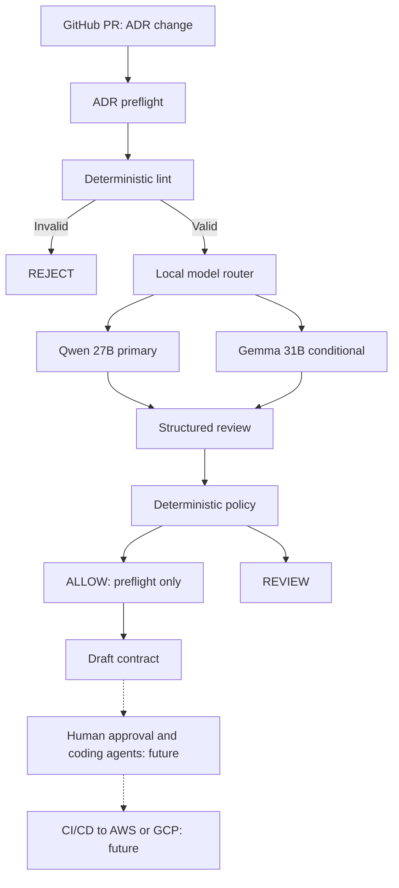

# EDH ADR Preflight — architectural admission PoC

A standalone demonstration of architecture-to-execution governance for agentic software delivery. Deterministic ADR checks precede local LLM semantic review; a deterministic policy interprets the review, never granting runtime permissions. AWS/GCP are example delivery targets, not deployed infrastructure.

## Architecture



See [detailed architecture and routing](docs/architecture.md). PRs run fixture regression and a separate trusted-base structural check of changed proposed ADRs; valid proposals remain REVIEW pending semantic review. Real model inference is available through the local CLI and the manually dispatched BYOI (Bring Your Own Inference) workflow. A separate private-only runner template is documentation only. Live model validation has not yet been performed.

## Quick demo (Python 3.10+, no packages)

```sh
python3 -m unittest discover -s tests -v
python3 preflight.py --mode fixture --case clean --output reports/clean.json
python3 preflight.py --mode fixture --case conflict --output reports/conflict.json
python3 preflight.py --mode fixture --case incomplete --output reports/incomplete.json
```

The last two commands intentionally return 2 and 3. Fixture mode uses deterministic canned findings, not inference. The accepted baseline ADR-0001 prohibits production credentials in coding agents. ADR-0002 is compatible; ADR-0003 contradicts it; ADR-0004 is incomplete. Reports include source and policy hashes, reviewer status, evidence quotes and timing. The example draft contract is human-authored for ADR-0002 and bound to the source hashes in the report; this is not yet a general-purpose contract compiler.

## Live local inference

Run these from the repo directory on the Mac, with the llama.cpp servers already available. Discover exact served model IDs before using them:

```sh
curl -fsS http://127.0.0.1:8080/v1/models
curl -fsS http://127.0.0.1:8081/v1/models
```

```sh
export ADR_PRIMARY_URL=http://127.0.0.1:8080/v1
export ADR_PRIMARY_MODEL='REPLACE_WITH_ACTUAL_QWEN_ALIAS'
export ADR_INDEPENDENT_URL=http://127.0.0.1:8081/v1
export ADR_INDEPENDENT_MODEL='REPLACE_WITH_ACTUAL_GEMMA_ALIAS'
python3 preflight.py --mode live --case clean --output reports/live-clean.json
python3 preflight.py --mode live --case conflict --output reports/live-conflict.json
```

Optional lightweight triage: configure `ADR_TRIAGE_URL` and `ADR_TRIAGE_MODEL` for a separate loopback server (e.g. Qwen 4B, not included). Optional auth is supported through `ADR_PRIMARY_API_KEY`, `ADR_INDEPENDENT_API_KEY`, `ADR_TRIAGE_API_KEY` in the local environment; do not commit keys. The local default permits only loopback HTTP API bases ending in /v1; set ADR_ENDPOINT_POLICY=https-only for trusted HTTPS endpoints. Addresses and ports are configurable. Proxies and redirects are disabled. No paid fallback. Use the exact model IDs reported by your installed llama-server. JSON schema support depends on server build/chat template; malformed or truncated outputs fail closed into REVIEW.

## Bring Your Own Inference (GitHub Actions)

The [semantic validation action](.github/workflows/adr-semantic.yml) runs manually on GitHub-hosted Ubuntu, only on main. Fork or clone this repository into an account where you have write access; enable Actions if needed. Use only synthetic ADRs and dedicated, low-privilege inference credentials because reports in public repositories are public.

Configure **Settings → Secrets and variables → Actions → Variables**:

| Variable | Example (replace with your own reachable service) |
|---|---|
| ADR_PRIMARY_URL | https://inference.example.org:8443/v1 |
| ADR_PRIMARY_MODEL | your-primary-model-id |
| ADR_INDEPENDENT_URL | https://review.example.org:9443/v1 |
| ADR_INDEPENDENT_MODEL | your-independent-model-id |
| ADR_TRIAGE_URL | optional HTTPS API base |
| ADR_TRIAGE_MODEL | optional triage model ID |

URLs include the scheme, hostname, optional custom port and API base ending in /v1. Hosted runners require HTTPS with a valid certificate and a reachable endpoint. localhost on GitHub is not your workstation. Do not expose a personal workstation to the internet just to run this demo.

If authentication is needed, set repository **Secrets** ADR_PRIMARY_API_KEY, ADR_INDEPENDENT_API_KEY and optionally ADR_TRIAGE_API_KEY. Never put keys in URLs, variables or dispatch inputs. Configure trusted endpoint URLs in repository Variables, not in PRs or model responses. Use dedicated disposable credentials; an inference provider receives its own token and the synthetic documents.

Open **Actions → ADR preflight - semantic validation (BYOI) → Run workflow**. Select a synthetic case and optionally override model IDs. Choose adaptive or always_independent routing and a per-request timeout (1–300 seconds). Empty overrides use repository Variables. Missing required model configuration or provider errors result in REVIEW; invalid ADRs return REJECT before contacting providers. REVIEW and REJECT produce nonzero exit codes intentionally; the summary and JSON report are still uploaded.

For a private-network endpoint use the local CLI or a separately isolated private execution environment. Never attach a self-hosted runner to this public repository. No third-party model has been tested for compatibility yet; the adapter expects the structured-output contract used by the current llama.cpp client.

## Routing and policy

1. Lint proposed ADR and accepted baseline. Any structural failure => REJECT (3) without inference.
2. Optional lightweight triage; primary reasoning is always required.
3. Independent review on high risk, any finding or reviewer failure; always_independent also invokes it for a clean low-risk ADR.
4. Any finding, reviewer failure or high-risk classification => REVIEW (2). No findings on low-risk valid input => ALLOW (0), meaning preflight pass only. Human approval is mandatory before any actual execution; the PoC never dispatches agents, changes cloud resources or grants credentials. A model may miss a conflict or invent a plausible interpretation; exact quotation verification is not semantic truth verification. Risk labels are untrusted human inputs in this demo; production risk classification must be enforced independently.

## GitHub Actions

`adr-fixtures.yml` runs unit tests and all three synthetic cases on GitHub-hosted runners. Its success proves fixture behavior only. 

[Private-only runner template](docs/examples/adr-live.private.yml) is deliberately outside `.github/workflows`. Do not enable it in a public repository or attach a daily-use Mac as a self-hosted runner. Run live examples via the local CLI on a trusted machine or use the hosted BYOI workflow with operator-configured HTTPS endpoints. No private infrastructure or production credentials are needed. Public CI must use GitHub-hosted runners; any future private inference integration requires a separately isolated execution boundary. The PR structural workflow reads ADRs against the base revision; it is a demo check, not an immutable security boundary. Protect workflow definitions before relying on it for enforcement.

## Validation status

The [initial fixture CI run](https://github.com/edh-project/edh-adr-preflight/actions/runs/45484648754) completed successfully. Seven unit tests and three synthetic scenarios passed. This is evidence of deterministic fixture behavior, not live inference accuracy. Live Qwen/Gemma runs, agent execution and cloud deployments remain unverified or out of scope.

## Integration roadmap (not implemented)

- Connect changed-ADR PR structural reports to a bounded semantic review executor; support arbitrary ADR inputs in live inference.
- Real acceptance dataset, repeated live runs, false-accept / false-reject metrics and cost/latency comparisons across models.
- Canonical policy and execution contract schemas, signed human approvals, replay protection and EDH admission integration.
- Reusable GitHub workflow and integration with IDP / AWS/GCP delivery pipelines.

References: [llama.cpp server API](https://github.com/ggml-org/llama.cpp/blob/master/tools/server/README.md), [GitHub Actions security](https://docs.github.com/en/actions/reference/security/secure-use).
