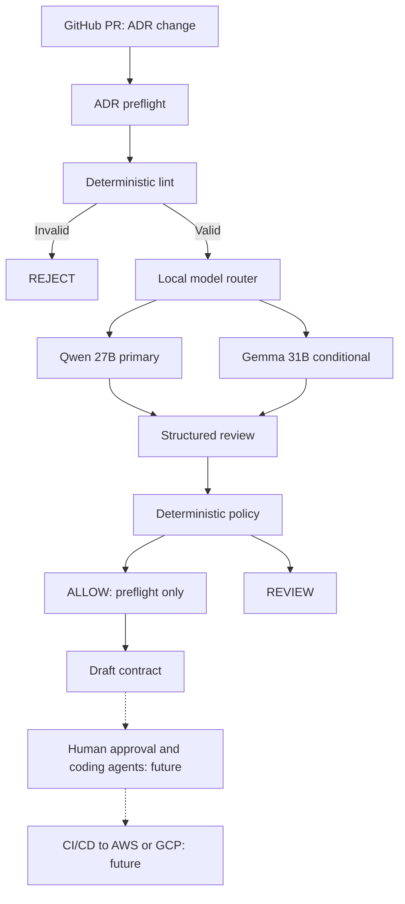

# EDH ADR Preflight — architectural admission PoC

A standalone demonstration of architecture-to-execution governance for agentic software delivery. Deterministic ADR checks precede local LLM semantic review; a deterministic policy interprets the review, never granting runtime permissions. AWS/GCP are example delivery targets, not deployed infrastructure.

## Architecture



See [detailed architecture and routing](docs/architecture.md). PRs run fixture regression and a separate trusted-base structural check of changed proposed ADRs; valid proposals remain REVIEW pending semantic review. Real model inference is available through the local CLI and a disabled-by-default manual workflow.

## Quick demo (Python 3.10+, no packages)

```sh
python3 -m unittest discover -s tests -v
python3 preflight.py --mode fixture --case clean --output reports/clean.json
python3 preflight.py --mode fixture --case conflict --output reports/conflict.json
python3 preflight.py --mode fixture --case incomplete --output reports/incomplete.json
```

The last two commands intentionally return 2 and 3. Fixture mode uses deterministic canned findings, not inference. The accepted baseline ADR-0001 prohibits production credentials in coding agents. ADR-0002 is compatible; ADR-0003 contradicts it; ADR-0004 is incomplete. Reports include source and policy hashes, reviewer status, evidence quotes and timing. The example draft contract is human-authored for ADR-0002 and bound to the source hashes in the report; this is not yet a general-purpose contract compiler.

## Live local inference

Run these from the repo directory on the Mac, with the llama.cpp servers already available. Discover exact served model IDs before using them:

```sh
curl -fsS http://127.0.0.1:8080/v1/models
curl -fsS http://127.0.0.1:8081/v1/models
```

```sh
export ADR_PRIMARY_URL=http://127.0.0.1:8080/v1
export ADR_PRIMARY_MODEL='REPLACE_WITH_ACTUAL_QWEN_ALIAS'
export ADR_INDEPENDENT_URL=http://127.0.0.1:8081/v1
export ADR_INDEPENDENT_MODEL='REPLACE_WITH_ACTUAL_GEMMA_ALIAS'
python3 preflight.py --mode live --case clean --output reports/live-clean.json
python3 preflight.py --mode live --case conflict --output reports/live-conflict.json
```

Optional lightweight triage: configure `ADR_TRIAGE_URL` and `ADR_TRIAGE_MODEL` for a separate loopback server (e.g. Qwen 4B, not included). Optional auth is supported through `ADR_PRIMARY_API_KEY`, `ADR_INDEPENDENT_API_KEY`, `ADR_TRIAGE_API_KEY` in the local environment; do not commit keys. Only loopback HTTP /v1 endpoints are accepted, with proxies and redirects disabled. No paid fallback. Use the exact model IDs reported by your installed llama-server. JSON schema support depends on server build/chat template; malformed or truncated outputs fail closed into REVIEW.

## Routing and policy

1. Lint proposed ADR and accepted baseline. Any structural failure => REJECT (3) without inference.
2. Optional lightweight triage; primary reasoning is always required.
3. Independent review on high risk, any finding or reviewer failure.
4. Any finding, reviewer failure or high-risk classification => REVIEW (2). No findings on low-risk valid input => ALLOW (0), meaning preflight pass only. Human approval is mandatory before any actual execution; the PoC never dispatches agents, changes cloud resources or grants credentials. A model may miss a conflict or invent a plausible interpretation; exact quotation verification is not semantic truth verification. Risk labels are untrusted human inputs in this demo; production risk classification must be enforced independently.

## GitHub Actions

`adr-fixtures.yml` runs unit tests and all three synthetic cases on GitHub-hosted runners. Its success proves fixture behavior only. It is safe to publish as a standalone demo subject to normal repo review.

`adr-live.yml` is a manual private-only workflow. Do NOT register your daily-use Mac as a public or broadly accessible self-hosted runner. Prefer executing the local CLI first, then an isolated trusted runner or an EDH outbound task executor. For an isolated private runner, restrict repo/runner access, use a dedicated account/environment, label `adr-preflight`, and set `ADR_ENABLE_PRIVATE_RUNNER=true` plus exact model aliases in repo variables. Default branch must be `main`. Keep the repo private while any runner is attached; guards inside YAML are not a security boundary against collaborators who can edit workflows. The current workflow uploads synthetic review reports; do not use sensitive ADRs without redesigning artifact handling. No fork PR runs on a local runner. Pin action SHAs and harden runner identity before enterprise adoption.

## Integration roadmap (not implemented)

- Connect changed-ADR PR structural reports to a bounded semantic review executor; support arbitrary ADR inputs in live inference.
- Real acceptance dataset, repeated live runs, false-accept / false-reject metrics and cost/latency comparisons across models.
- Canonical policy and execution contract schemas, signed human approvals, replay protection and EDH admission integration.
- Reusable GitHub workflow and integration with IDP / AWS/GCP delivery pipelines.

References: [llama.cpp server API](https://github.com/ggml-org/llama.cpp/blob/master/tools/server/README.md), [GitHub Actions security](https://docs.github.com/en/actions/reference/security/secure-use).
