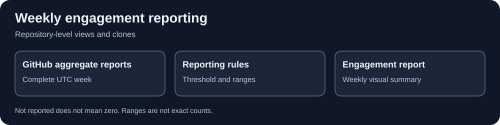
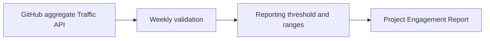

# Project engagement analytics — methodology

This report presents weekly repository engagement using GitHub's aggregate Traffic API.

## Reporting rules

- Complete Monday–Sunday UTC weeks, evaluated at least 48 hours after the period ends.
- Repository views and clones are expressed as ranges rather than exact counts.
- A metric is reported only when all seven daily observations are available and the minimum distinct-count threshold is met.
- “Not reported” does not mean zero.
- Published weekly records are fixed. Daily unique counts are not added to estimate weekly unique visitors.
- The report covers repository-level engagement; it does not estimate separate Wiki readership.

[View the Project Engagement Report](engagement/README.md).

[GitHub Traffic API reference](https://docs.github.com/en/rest/metrics/traffic).
