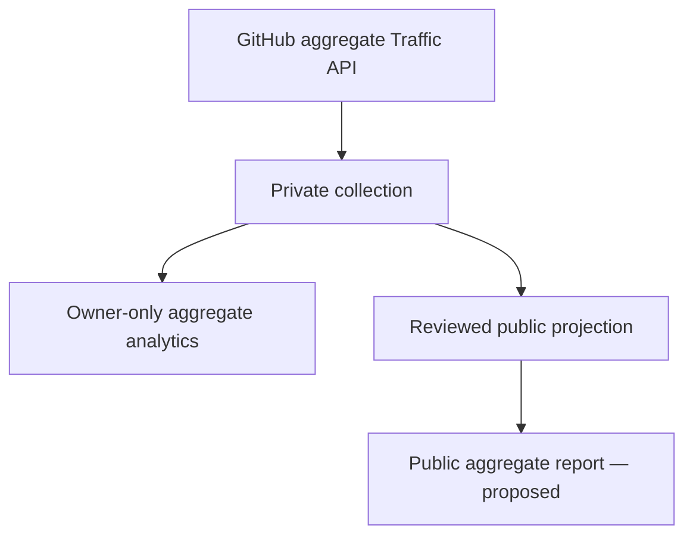

# Project engagement analytics — methodology

**Design note.** This document describes the intended public reporting and private owner analytics model. It does not claim that a public dashboard or a separate Wiki tracking service has been deployed.

## Two reporting tiers

| Metric | Public reporting (proposed) | Private owner analytics |
|---|---|---|
| Repository views and clones | Reviewed aggregate totals | Full available aggregate reports |
| GitHub-reported unique counts | Reviewed aggregate totals | Full available aggregate reports |
| Daily trends | Coarsened where appropriate | Reported daily series |
| Popular documents | Reviewed aggregates | Returned popular paths |
| Referrers | Not published | Returned aggregate referrers |
| Historical snapshots | Not published | Private historical archive |

GitHub Traffic API reports are aggregate, limited to the supported reporting window and popular-path/referrer lists. They do not provide individual visitor IP addresses, network organizations, identities or guaranteed separate Wiki readership metrics. Missing Wiki entries do not establish zero Wiki visits. Unique counts from different days or overlapping windows must not be summed to infer distinct people.

## Privacy and publication boundary

Public reports are derived outputs containing reviewed fields and appropriately aggregated periods; small cohorts may be suppressed. Public reporting must not expose credentials, private infrastructure details, raw historical snapshots or direct access to private storage.

No hidden tracking pixels, external image beacons, GitHub Wiki proxy bypass or individual visitor attribution are part of this methodology.

A separately hosted documentation portal, if introduced later, would require transparent analytics disclosure, data minimization, appropriate consent where applicable, broad aggregate network and geographic reporting, suppression of small cohorts, and no default persistence of raw visitor IP addresses. No such portal is claimed to be deployed by this document.

## References

- [GitHub REST API — repository traffic](https://docs.github.com/en/rest/metrics/traffic)
- [GitHub anonymized image URLs](https://docs.github.com/en/authentication/keeping-your-account-and-data-secure/about-anonymized-urls)
