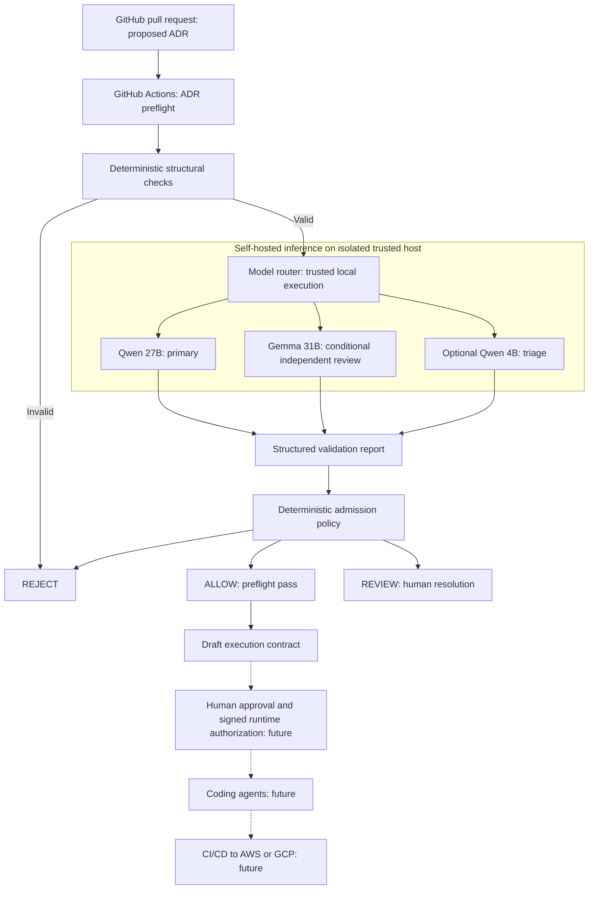
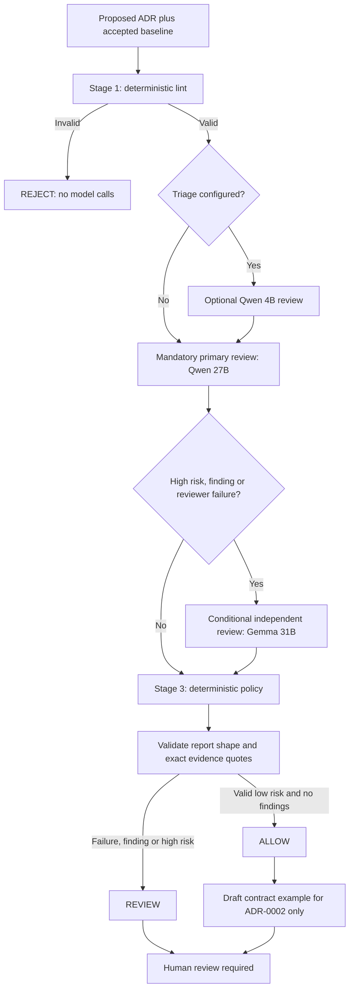

# Architecture and trust boundaries

## End-to-end target architecture

The fixture CI does not call a model. The live CLI/manual workflow runs the same three synthetic examples through local inference. The separate PR structural workflow reads changed proposed ADRs as data using the base revision policy and baseline; structurally valid proposals stay REVIEW until semantic review. It does not call a model. The solid lines represent PoC logical components, not a deployed end-to-end integration; dashed lines are explicitly out of scope. `ALLOW` is not permission to execute.

## Detailed routing and policy

Review shape and quotations are actually checked before the escalation decision as well as being inputs to policy. Exact quote matching does not prove the model interpretation correct. A high-risk classification is not inferred automatically; the demo reads the ADR risk field. No workflow grants credentials or executes a patch.

## Trust and exposure

- Keep this repository private; only synthetic ADRs and reports belong here.
- No organization-wide token, private reusable workflow, internal EDH data or production secret.
- Default CI runs on GitHub-hosted Ubuntu. The manual local-runner workflow stays disabled until a separately isolated runner is explicitly configured. Do not attach a daily-use Mac.
- The local CLI restricts inference endpoints to loopback HTTP and disables proxying and redirects. Models are untrusted reviewers, not policy authorities.
- The policy records source and code hashes for auditability; these are not signed attestations.
- Production integration requires immutable workflow enforcement, bounded semantic review of changed ADRs, isolated execution, signed authorization, an acceptance dataset and independent verification.

## Evidence

Each GitHub Actions summary distinguishes fixture from live results and includes candidate, decision, expected fixture outcome, reviewer role, requested/reported model, timings, token usage when available, findings and source quotes. JSON artifacts contain hashes and the draft contract example. No claims about real model accuracy follow from fixture tests.
