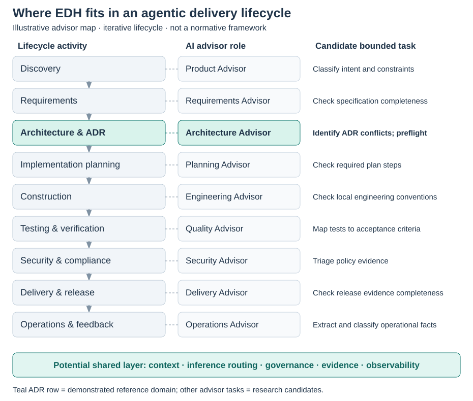
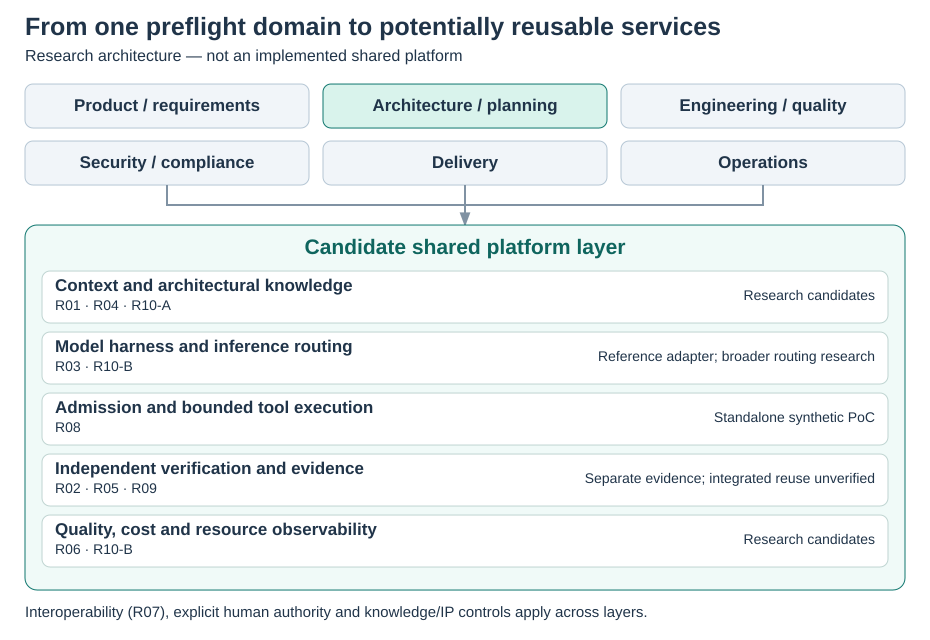

# A-SDLC Platform Architecture & Research Overview

**Executive engineering brief · EDH ADR Preflight · 27 November 2026**

[Repository home](../README.md) · [Engineering evidence](https://github.com/edh-project/edh-adr-preflight/wiki/Engineering-Evidence-and-Development-Roadmap) · [Research portfolio R01–R09](https://github.com/edh-project/edh-adr-preflight/wiki/A-SDLC-Research-Portfolio) · [R10 research proposal](research/r10/README.md)

## Why this matters

In an agentic software delivery lifecycle, an AI advisor can turn a requirement, architectural decision or operational observation into significant downstream engineering work. Checking architectural intent before implementation is a practical first control point. It is also a useful domain in which to investigate a broader platform question:

**Which governance, context, inference and evidence services can be reused across specialized AI advisors, and how can their reliability and operating cost be measured before organization-wide adoption?**

EDH ADR Preflight is a bounded reference implementation, not an enterprise-wide advisor platform. Its deterministic checks, model-assisted review and evidence contracts provide a concrete starting point. The research portfolio explores whether such mechanisms can be generalized and reused rather than recreated independently for every advisor. Existing organizational capabilities should be evaluated first; EDH is not a proposal to replace an established IDP or SDLC.

## 1. Position in the A-SDLC

*Figure 1. Illustrative lifecycle and advisor roles, not a canonical A-SDLC standard. Activities are iterative and overlapping; security, governance and verification are cross-cutting. The named advisors are conceptual roles, not nine deployed agents or a reproduction of an external framework.*

[Editable Mermaid source](assets/asdlc-advisor-landscape.mmd) · [Current ADR preflight architecture](architecture.md)

The primary demonstrated domain is **Architecture & ADR**, before implementation. Other advisor roles illustrate possible bounded workloads for future evaluation. For example, evidence extraction, requirement classification and completeness checks may be candidates for deterministic rules or small-model inference. Complex decisions, critical risks and execution authority remain governed separately.

## 2. Potential shared infrastructure

*Figure 2. Candidate platform architecture. Component evidence is not proof of integrated or cross-advisor reuse.*

[Editable Mermaid source](assets/asdlc-shared-platform.mmd)

| Candidate shared service | Research relationship | What to investigate |
| --- | --- | --- |
| Specification and context | R01, R04, R10-A | Versioned facts, access, provenance and relevance; equivalent Markdown/JSON/JSONL comparisons |
| Model-agnostic harness and routing | R03, R10-B | Replaceable inference adapters; minimum sufficient model capability and risk-aware escalation |
| Governed execution | R08 | Deterministic admission, exact authorization binding, bounded tools and receipts |
| Independent verification and evidence | R02, R05, R09 | Separation of verification from generation; controlled release of engineering evidence |
| Empirical quality, cost and observability | R06, R10-B | Correct-task cost, risk, latency, concurrency, rework and resource utilization |
| Interoperability | R07 | Portable contracts and integration with existing systems rather than duplicating them |

The service boundaries are hypotheses for review, not product commitments. Model output is not execution authority, and context disclosure requires explicit authorization.

## 3. Demonstrated vs proposed

| Capability | Evidence / maturity |
| --- | --- |
| Deterministic ADR preflight | Implemented reference; [fixture CI](https://github.com/edh-project/edh-adr-preflight/actions/runs/45622863474). |
| Model-assisted ADR review | Configurable inference adapter; [synthetic local matched-pair evidence](evidence/adr-live-matched-pair.md). Both compatible and conflicting cases required human review in that run; it does not establish general accuracy. |
| Governed MCP execution (R08) | [Standalone synthetic reference](https://github.com/edh-project/edh-mcp); [acceptance CI](https://github.com/edh-project/edh-mcp/actions/runs/45615956732). Not integrated enterprise execution. |
| Evidence publication (R09) | Locally tested implementation candidate, with cross-repository activation and independent public delivery unverified in the [portfolio readiness record](https://github.com/edh-project/edh-adr-preflight/wiki/A-SDLC-Research-Portfolio#r09--current-technical-readiness). |
| Structured context and small-model effectiveness (R10-A) | Research proposal; no demonstrated format superiority or measured cross-advisor accuracy. |
| Multi-tier inference economics (R10-B) | Research proposal; 10–15% overall budget reduction is an exploratory scenario, not measured savings or a target commitment. The current reference requires primary reasoning even with optional lightweight triage; small-model early exit is proposed, not demonstrated. |
| Integrated advisor infrastructure | Proposed; no nine-advisor deployment, production authorization, enterprise integration or proven generalization. |

## 4. Where to go next

| Reviewer | Recommended next read | Question for review |
| --- | --- | --- |
| Senior Architect | [Architecture and routing](architecture.md) · [Technical review & acceptance case](https://github.com/edh-project/edh-adr-preflight/wiki/Technical-Review-and-Acceptance-Case) | Are the control points and authority boundaries appropriate? Which existing architectural mechanisms should be reused? |
| Staff / Principal Engineer | [Engineering evidence & roadmap](https://github.com/edh-project/edh-adr-preflight/wiki/Engineering-Evidence-and-Development-Roadmap) · [R08 reference](https://github.com/edh-project/edh-mcp) · [R10 methodology](research/r10/README.md) | Which shared contracts, workloads and evaluation methods justify a bounded integration experiment? |
| Platform / Engineering Owner | [R10 engineering overview and economics](research/r10/README.md#engineering-overview--why-this-research-matters) · [Research portfolio](https://github.com/edh-project/edh-adr-preflight/wiki/A-SDLC-Research-Portfolio) | Is there a material eligible workload, a measurable baseline and an accountable owner for a pilot? |

## 5. Proposed next decision

Select one representative, authorized workload and a bounded acceptance case. Identify existing platform services and alternatives, agree success and risk criteria, and measure against deterministic, local and appropriate cloud baselines. Determine whether any component warrants further integration. This preserves the scope of the existing PoC and the separate Experiment 003 readiness and knowledge/IP governance framework.

[Technical discussion and feedback](https://github.com/edh-project/edh-adr-preflight/discussions/3) · [R10 annotated references](research/r10/REFERENCES.md)

Public discussions and evidence must not include confidential organizational information. No new budget, staffing, integration or implementation commitment is implied by this overview.
