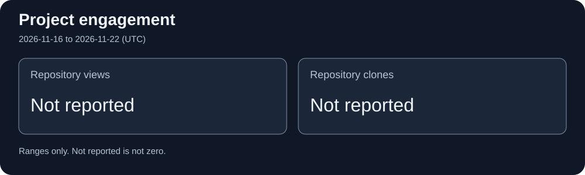
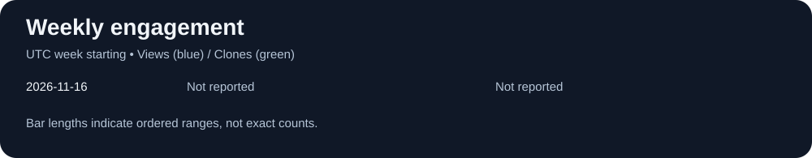

# Project Engagement Report

Public, privacy-aware aggregate reporting for ADR Preflight.

**Latest evaluated period:** 2026-11-16 to 2026-11-22 (UTC).

## Weekly engagement

| Week (UTC) | Views | Clones |
|---|---:|---:|
| 2026-11-16 – 2026-11-22 | Not reported | Not reported |

## Content engagement

## Methodology

Source: GitHub Traffic API. Fixed, complete UTC weeks only; ranges are not exact counts. A metric is not reported unless all seven daily observations are available and at least one day meets the minimum distinct-count threshold. Not reported does not mean zero. Weekly unique visitor totals are not estimated from daily unique counts. The report covers repository-level engagement, not separate Wiki readership.

Only released weekly records appear in the [machine-readable report](public-metrics.json). Figures are derived from GitHub aggregate traffic reports.
