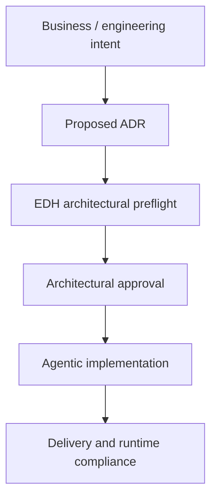
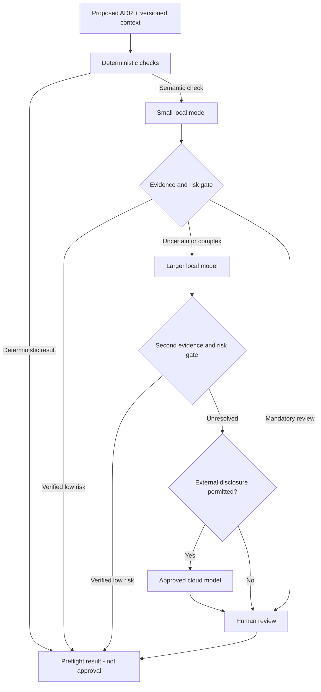
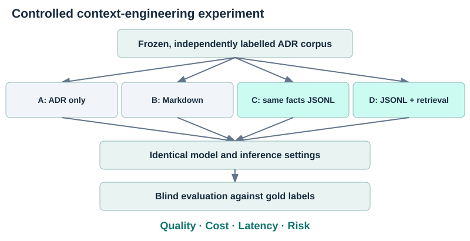
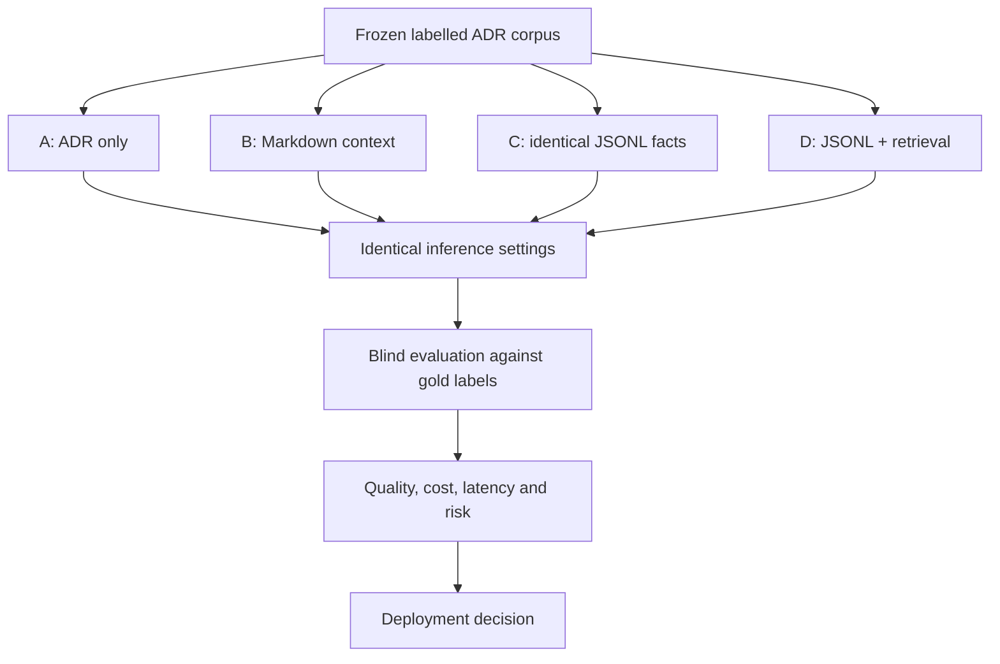

# R10 — Cost-Efficient Architectural Governance in Agentic SDLC

**Evaluating Small Language Models, Structured Architectural Context, and Multi-Tier Inference Cascades**

EDH Project · A-SDLC Research Portfolio · Candidate research proposal · 26 November 2026

[Research portfolio R01–R09 (Wiki)](https://github.com/edh-project/edh-adr-preflight/wiki/A-SDLC-Research-Portfolio)

**Status:** candidate; value unassessed; priority TBD; owner unassigned. Related to R01, R03, R04, R05 and R06. This is not an Experiment 004 authorization or a validated production capability.

## Abstract

Agentic software engineering introduces an architectural governance challenge: keeping proposed decisions consistent with organizational architecture, security policies, infrastructure constraints and accepted ADRs before implementation begins. Systematic use of frontier models for every validation request may add cost, latency, external dependency and disclosure risk. This proposal investigates whether locally deployed quantized small language models (SLMs), operating inside deterministic verification and risk-aware routing, can reliably perform a meaningful proportion of architectural preflight before escalation. Qwen3.5-4B Q5 is the initial candidate, not the research boundary. The objective is to identify minimum sufficient intelligence, capability limits, quality–cost trade-offs and safe escalation criteria, not replace architects or claim empirical results.

## 1. Research objective

Determine the minimum sufficient inference capability for reliable architectural preflight, minimizing total sustainable operational cost without compromising governance.


*Four research dimensions.*


## 2. Existing research and market evidence

| Research | Relevance |
| --- | --- |
| [Small Language Models are the Future of Agentic AI](https://arxiv.org/abs/2506.02153), NVIDIA Research, 2025 | Specialized small models for repetitive agentic workloads |
| [FrugalGPT](https://arxiv.org/abs/2305.05176), 2023 | Cost-aware inference cascades |
| [RouteLLM](https://arxiv.org/abs/2406.18665), 2024/2025 | Dynamic routing between weaker and stronger models |
| [Small Language Models for Agentic Systems](https://arxiv.org/abs/2510.03847), 2025 | SLM-first architectures and operational efficiency |
| [Evaluating Large Language Models for Detecting Architectural Decision Violations](https://arxiv.org/abs/2602.07609), 2026 | Reported post-implementation compliance study, 980 ADRs and 109 repositories |

The proposed contribution is specifically pre-implementation governance using structured architectural evidence, deterministic verification and local quantized inference. Existing compliance studies do not establish preflight accuracy. Literature claims and pricing snapshots are inherited from the proposal draft and should be reverified in the formal literature review.

### 2.1 Published capability indicators

| Benchmark | Qwen3.5-4B | Qwen3.5-9B |
| --- | ---: | ---: |
| IFEval | 89.8 | 91.5 |
| MMLU-Pro | 79.1 | 82.5 |
| GPQA Diamond | 76.2 | 81.7 |
| IFBench | 59.2 | 64.5 |
| LongBench v2 | 50 | 55.2 |
| BFCL v4 | 50.3 | 66.1 |
| DeepPlanning | 17.6 | 18 |


*Publisher-reported Qwen benchmarks; not quantized or ADR-specific results.*


Source: [Qwen model card](https://huggingface.co/Qwen/Qwen3.5-4B). Strong instruction-following results motivate bounded workload experiments; complex planning and tool use remain distinct capabilities. General benchmark scores do not predict ADR accuracy.

### 2.2 Quantization and hardware efficiency

| Quantization | File GB | Generation tok/s | Relative perplexity increase |
| --- | ---: | ---: | ---: |
| FP16 | 8.42 | 36.8 | baseline |
| Q8_0 | 4.48 | 54 | 0.18% |
| Q6_K | 3.46 | 62 | 0.54% |
| Q5_K_M | 3.11 | 56.6 | 1.74% |
| Q4_K_M | 2.71 | 58.5 | 4.07% |


*Community M2 Ultra quantization measurements; not EDH measurements.*


Source: [AtomGradient community benchmark](https://atomgradient.github.io/apple-silicon-llm-inference/). Q5 reduced file footprint by about 63% relative to FP16; Q6 was faster and less degraded in this particular report. Perplexity is not task accuracy. File size excludes runtime memory. Pin artifact hash, quantizer and runtime; confirm actual latency, memory and task quality.

### 2.3 Model comparison matrix

| Candidate | Experimental role |
| --- | --- |
| Qwen3.5-2B | Lower capacity boundary |
| [Qwen3.5-4B Q5](https://huggingface.co/unsloth/Qwen3.5-4B-GGUF) | Primary candidate |
| [Gemma 3 4B IT](https://gemma.ai/models/gemma-3/) | Alternative model family |
| Qwen3.5-9B | Intermediate tier |
| Local 27–31B | Higher-capability reasoning |
| Commercial cloud models | Budget and premium baselines |

## 3. Position within the Agentic SDLC


*Figure 1. Upstream architectural control point.*



Preflight is advisory, distinct from architectural approval and downstream runtime compliance.

## 4. Research questions and hypotheses

| ID | Research question |
| --- | --- |
| RQ-01 | Minimum sufficient model capacity by workload? |
| RQ-02 | Does structured context improve quality over semantically identical unstructured context? |
| RQ-03 | How do quantization levels affect quality, latency, memory and energy? |
| RQ-04 | What share can be locally resolved at bounded error? |
| RQ-05 | When does local or hybrid inference outperform cloud-only economically? |
| RQ-06 | Does early feedback reduce downstream implementation rework? |

H1: bounded workloads can be delegated to SLMs. H2: structured context and retrieval improve performance without increasing parameters. H3: evidence verification and calibrated routing reduce reliance on larger models while bounding risk. H4: local or hybrid inference can reduce cost per correct validation at sufficient utilization. H5: early contradiction detection may reduce rework. All are falsifiable, not results.

## 5. Multi-tier inference architecture


*Figure 2. Inference cascade; mandatory human review overrides all early exits.*



Deterministic checks take precedence. Versioned context contains accepted ADRs, policies and evidence. Verify references and quotations, validate schemas, and independently evaluate semantic support: a valid citation does not prove entailment. Escalate on evidence completeness, calibrated error rates and severity, not self-reported model confidence alone. Cloud disclosure requires explicit permission; otherwise use local or human review. No model output constitutes approval or execution authority. Treat ADR text as untrusted data and test prompt injection, stale evidence and conflicting requirements.

## 6. High-value enterprise workloads

| Workload | Expected SLM suitability | Potential value |
| --- | --- | --- |
| ADR classification and tagging | High | Metadata automation |
| Requirement and constraint extraction | High | Reusable knowledge |
| Explicit contradiction detection | High | Early feedback |
| Evidence and ADR matching | High | Traceability |
| Duplicate or overlapping ADR detection | High | Reduced fragmentation |
| Missing architectural considerations | Conditional | Completeness |
| Component dependency analysis | Conditional | Integration risks |
| Implicit security implications | Limited | Preliminary screening |
| Distributed system failure analysis | Limited | Escalation candidate |
| Autonomous architecture approval | Out of scope | Organizational accountability |

These are hypotheses. Prefer reliable deterministic rules where possible.

## 7. Experimental methodology



*Figure 3. Context ablation experiment.*



| Comparison | Isolated variable |
| --- | --- |
| A vs B | Availability of architectural context |
| B vs C | Representation of identical facts |
| C vs D | Retrieval and context selection |

Freeze prompts, context versions, model hashes, runtime, seeds and settings. Match semantic facts in Markdown/JSONL; report token counts and token-budget-matched sensitivity. Separate thinking/non-thinking. Compare Q4/Q5/Q6/Q8 and optional BF16 on identical cases. Include deterministic-only, direct larger local, direct budget cloud, direct premium cloud and cascade baselines. Independently label cases with expert adjudication, not model-as-ground-truth. Separate calibration from final holdout; repeat seeds and use paired confidence intervals. Include critical and adversarial cases.


*Proposed pilot dataset: 20 cases in each of six categories.*


120 cases is a feasibility pilot, not certification of production safety. Expand independent holdout before any automatic blocking or acceptance.

## 8. Enterprise inference economics

Compare cost per correctly resolved validation at equivalent quality, risk and service levels, not only cost per token. Example workload: 10,000 requests/month, 8,000 uncached input and 1,000 billed output tokens per cloud call.

| Draft cloud pricing snapshot | Input USD / 1M | Output USD / 1M | Example monthly USD |
| --- | ---: | ---: | ---: |
| GPT-6.2 Astra | 8 | 40 | 1,040 |
| GPT-6.2 Sol | 2 | 10 | 260 |
| Claude Opus 5.5 | 4 | 20 | 520 |
| Claude Sonnet 5.5 | 2 | 10 | 260 |
| Claude Haiku 5.5 | 0.10 | 0.50 | 13 |

Source links: [OpenAI pricing](https://developers.openai.com/api/docs/pricing), [Anthropic pricing](https://platform.claude.com/docs/en/about-claude/pricing). These draft rate inputs have **not been independently reverified for this publication**; reprice before decisions. Include caching, batch discounts, billed reasoning and retries.

Hybrid example: fixed local $150/month, $0.002 per SLM request, 20% reach larger local at $0.01, 10% reach premium cloud at $0.104. Cloud is a subset of larger-local escalation. Total $294 versus $1,040 for premium-only (71.7% illustrative reduction). Hybrid is more expensive than budget cloud in this example; quality parity is not demonstrated. Human review, differential operations and error costs are excluded.


*Illustrative premium cloud versus hybrid costs.*


For monthly volume N, fixed cost F, per-request small-local cost v_s, larger-local cost v_l and cloud cost c, with unconditional escalation fractions r_l and r_c:

```text
C_hybrid = F + N * (v_s + r_l*v_l + r_c*c)
C_cloud  = N*c
Break-even N > F / ((1-r_c)*c - v_s - r_l*v_l)
```

The denominator must be positive; illustrative Astra break-even is about 1,675 validations/month. Evaluate 1k/10k/100k workloads, utilization, concurrency and service-level constraints. The same formula supports sensitivity analysis across cloud rates, prompt sizes and escalation fractions.


*Total cost of ownership components.*


TCO includes amortization, redundant capacity, electricity/cooling, monitoring, upgrades, on-call, retries, audit, review and failure/rework. **Cost per correct validation = total attributable cost / correctly resolved validations.** Include human review where required.

## 9. Metrics and pilot criteria

| Metric | Proposed target |
| --- | --- |
| Explicit violation recall | ≥95% |
| Violation precision | ≥90% |
| Implicit violation recall | ≥75% |
| Correct abstention with insufficient evidence | ≥85% |
| Schema validity and reference integrity after checks | 100% for accepted outputs |
| Macro-F1 improvement from structured context | Explore ≥10 percentage points |
| Premium model invocation reduction | Explore ≥70% subject to risk |
| P95 latency for bounded checks | Explore ≤15 seconds |
| Cost per correct validation | Below quality-matched baseline |

Report per-class recall/precision, critical false acceptance, semantic evidence support, risk–coverage, calibration, retries, fallback, P50/P95 latency, input/output/reasoning tokens, prefill and generation throughput, peak RAM/VRAM, concurrency, energy, availability and rework. UNKNOWN is abstention, not success. Report confidence intervals and class counts.


*Conceptual risk–coverage curve — synthetic, not experimental results.*


The desired outcome can be higher locally resolved coverage at the same residual risk. All thresholds are exploratory; revise from evidence.

## 10. Research deliverables


*Six proposed research deliverables.*


1. Reproducible dataset and evaluation harness, capability matrix and provenance.
2. Context ablation and quantization report with uncertainty.
3. Inference resource profile and calibrated escalation boundaries.
4. Enterprise economics: sensitivity, TCO and quality-matched comparisons.
5. Advisory IDP/CI/CD integration; separate organizational approval for production admission.

## 11. Research significance

The question is not how to add an LLM to CI/CD, but how much intelligence each stage requires and how to provision it at the lowest sustainable cost without compromising architectural governance. Negative outcomes and measured limits are useful. No enterprise savings, deployment readiness or novelty priority is claimed. Research scope, ownership, budget and permitted data remain subject to Experiment 003 governance.

## Source assets

All eleven SVG graphics are in [assets](assets/). Three architecture diagrams also have editable Mermaid sources: [SDLC](assets/01-sdlc-control-point.mmd), [cascade](assets/02-inference-cascade.mmd), [experiment](assets/03-experimental-design.mmd). Graphics are recreated vector illustrations, not screenshots of the chat. The GitHub edition is static; the separate HTML edition has the interactive calculator.
