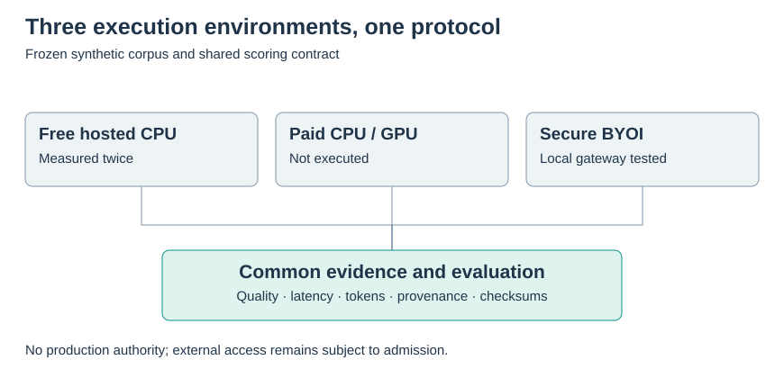
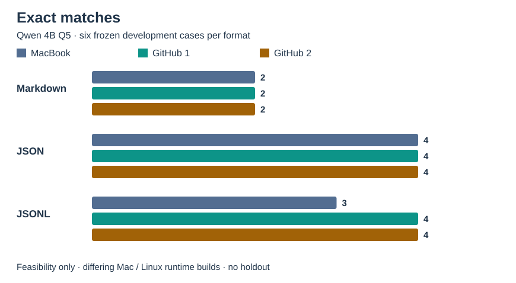
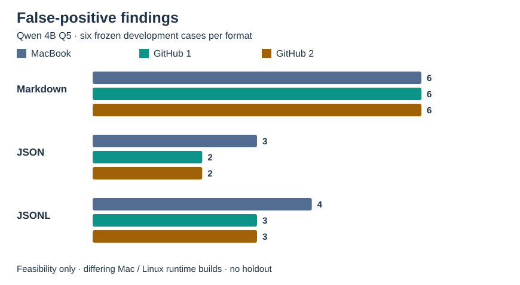
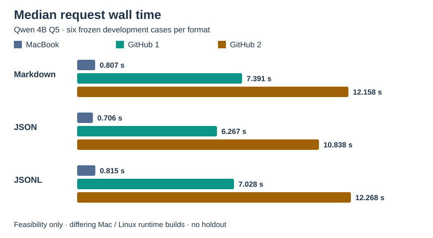
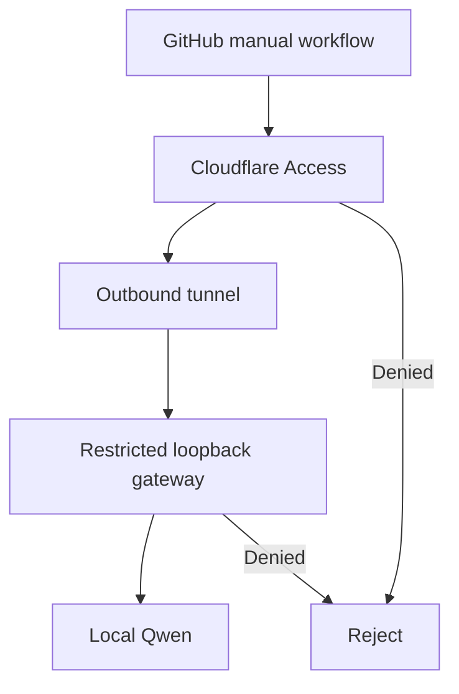
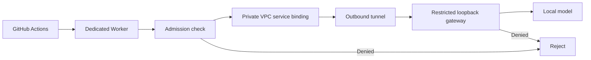
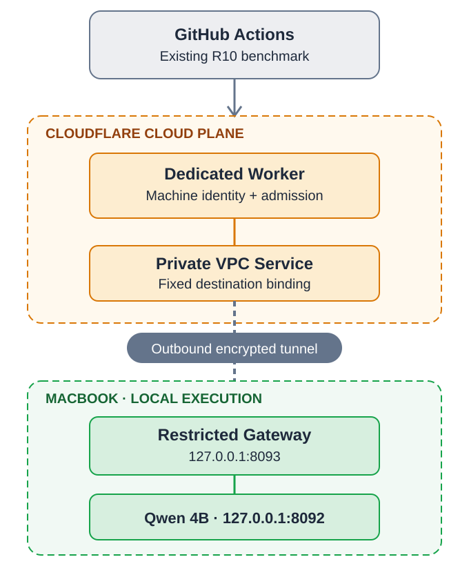

# From Architectural Preflight to Reproducible Inference Infrastructure

**EDH Applied Research · R10 · Engineering Research Report · 27 November 2026**

> Can a small, locally hosted language model resolve bounded architectural checks reliably enough to reduce dependence on premium inference, without compromising governance?

## Executive perspective

The first 54 benchmark calls across a Mac and two public GitHub-hosted runs establish feasibility, not production readiness. The hosted runs reproduced every validated finding, yet median latency increased by 64–75%. Structured context showed fewer false positives than Markdown on this small corpus. The next question is not which model wins a leaderboard, but which workload can be delegated at a measured risk and cost.

| Evidence at a glance | Observation |
|---|---|
| Benchmark calls | 54 across three runs; six reused cases |
| Execution environments | Mac Metal and GitHub CPU |
| Hosted semantic agreement | 18/18 case-format pairs |
| Hosted correctness | 10/18 exact in each run |
| Local restricted gateway | 9 unit tests and 5 HTTP checks passed; one real inference |

## 1. Architectural motivation

A-SDLC advisors need bounded context, evidence validation and explicit authority boundaries before implementation. ADR preflight is the first testbed, not a claim of nine implemented advisors. [Platform overview](../../asdlc-platform-overview.md). R10-A examines representation and capability; R10-B examines resource allocation and inference economics. The wider [research proposal](README.md) remains the hypothesis register.

## 2. From feasibility to executable research

The original six-case pilot was recovered, its dataset and script hashes matched, and scores were recomputed. The exact 3.25 GB Qwen3.5-4B UD-Q5_K_XL GGUF hash matched upstream artifact metadata. A separate manual workflow preserves normal ADR CI and defaults to free public CPU. Paid and external modes require explicit authorization. Linux llama.cpp b12646 differs from the original Mac build.

[Workflow](../../../.github/workflows/r10-benchmark.yml) · [Harness](../../../experiments/r10/README.md)

## 3. Measured findings

All 54 outputs passed structural and reference validation. Only 29 of 54 were exact. Across the two hosted runs every case-format finding set matched, including wrong findings. Zero observed false negatives in this small corpus is not a safety guarantee. JSON and JSONL showed fewer false positives than Markdown; the experiment does not prove a causal format advantage. The same hosted behavior coexisted with substantially different latency. Host CPU identity and allocation were not measured in the historical runs; future provenance captures selected CPU and memory metadata.

[First hosted evidence](evidence/first-hosted/README.md) · [Second hosted evidence](evidence/hosted-repeat/README.md)

## 4. Evidence as a platform capability

Every new run produces a Markdown summary, three SVG charts, trial records, dataset, provenance, aggregate metrics and SHA-256 manifest. Selected reviewed synthetic evidence is preserved in Git; routine artifacts expire after seven days. No automatic commits from inference jobs. The second run confirmed all nine files and manifest hashes. This separates durable research evidence from ephemeral execution.

## 5. Secure bring-your-own-inference

The next environment is the Mac's existing loopback model, reached through a dedicated restricted gateway rather than a public model port or self-hosted runner. Proposed transport is Cloudflare Tunnel plus Access, with an additional bounded grant at the local gateway. Future GitHub OIDC and EDH capability admission may strengthen identity and audit. The local gateway candidate passed nine unit checks and five loopback HTTP checks, including one real inference, denial of unknown routes and payloads, and quota exhaustion. It has not been exposed externally. Transport, authorization, revocation, connection limits and end-to-end measurements remain acceptance gates.

### 5.1 Infrastructure discovery — DNS control-plane assumption failed (27 November 2026)

The initial public-hostname design assumed that the existing domain was an active Cloudflare DNS zone because the project already used Cloudflare compute services. That assumption failed during read-only provisioning preflight.

| Check | Observed result |
|---|---|
| Temporary provisioning identity | API verification returned active |
| Filtered Cloudflare zone lookup | Successful API response, zero visible matching zones |
| Public authoritative NS lookup | Registrar-operated DNS, not Cloudflare authoritative DNS |
| Provisioning preflight | Stopped before resource creation |
| DNS mutation / public inference exposure | None in this preflight |

The empty filtered lookup establishes that the token could not see the expected zone; it does not by itself prove global absence of the zone. The independent NS result confirms that the observed public delegation is not to Cloudflare. An active API token proves identity validity, not access to every required resource. The original DNS-dependent provisioning path is blocked.

**Decision:** preserve existing authoritative DNS and avoid a domain-wide migration for a development benchmark. Evaluate a dedicated Worker endpoint with a private Workers VPC service binding and an outbound tunnel to the restricted loopback gateway. Account entitlement, API permissions, binding configuration, machine authentication, gateway limits and negative-path tests must be verified before activation. This alternative is a candidate, not an implemented transport. A pull-based EDH executor remains a separate architectural alternative.

The figure preserves the chat architecture as a standalone SVG, with explicit local addresses and a dedicated Worker admission boundary. These are design targets, not deployment evidence. No public hostname or DNS migration is required by the proposed private-service topology.

**Read-only account discovery (27 November):** Wrangler 4.158.0 recognized `vpc service list`, returned `No VPC services found`, and exited with status 0. The authenticated list operation is confirmed; permission to create services and working private connectivity are not yet established.

The dedicated nine-call BYOI client adapter is proposed in [draft PR #10](https://github.com/edh-project/edh-adr-preflight/pull/10); the existing benchmark corpus and format protocol remain unchanged. No remote inference run has been demonstrated. Operational identifiers, domains and credentials are intentionally omitted from the public report.

**Engineering lesson:** separate domain ownership, authoritative DNS, connectivity, workload identity and execution authority. Verify each boundary independently before provisioning, and keep the inference transport replaceable.

## 6. Economics and enterprise relevance

Free public CI is a bounded repository experiment, not a persistent service or proof of zero total cost. The Mac was substantially faster on these calls; transport costs remain unknown. Paid runners and premium APIs have not been tested. Compare quality-adjusted cost per correctly resolved request, including hardware, operations, review, escalation and rework. The proposed 10–15% enterprise inference budget reduction remains a hypothesis. [Economic scenarios](github-inference-economics.md).

## 7. Next evidence gates

1. Validate transport and machine identity without exposing the Mac or private context.
2. Run the identical corpus through authorized BYOI; isolate admission, inference and end-to-end times.
3. Freeze independent calibration and holdout sets; expand to the proposed 120 scenarios only after protocol review.
4. Evaluate model size, quantization and selective escalation; measure risk–coverage before claiming economic benefit.

This report is an edited narrative of the measured work and design decisions, not a verbatim conversation or a peer-reviewed paper. Figures are generated from recorded aggregates; bibliography and price assumptions in the research proposal require separate verification. No production suitability, statistically significant superiority or realized savings are claimed.
