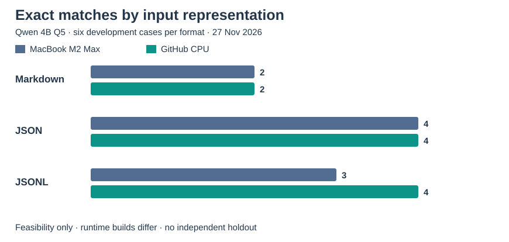
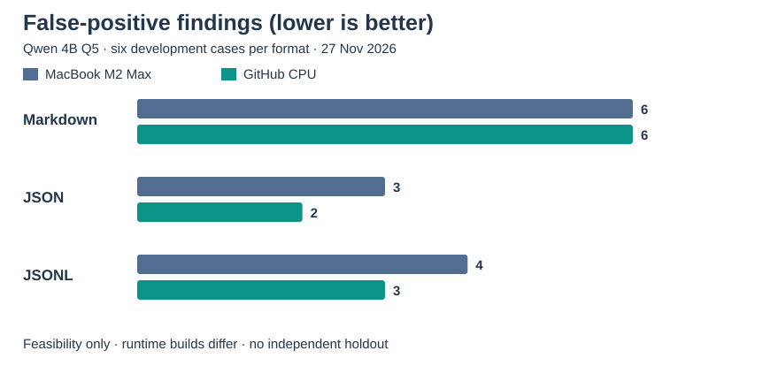
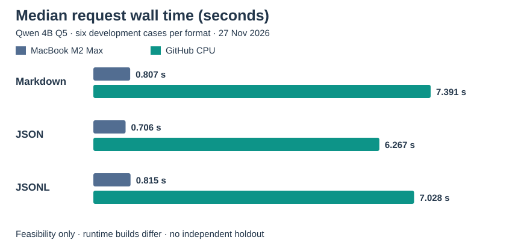

# R10-E01 — First GitHub-hosted inference evidence

**27 November 2026 · Development feasibility only · Run #45980022896**

[Original Actions run](https://github.com/edh-project/edh-adr-preflight/actions/runs/45980022896) · [Executed revision](https://github.com/edh-project/edh-adr-preflight/commit/abdac82ec73e8429887bd6101ee6cae6a7e56c35) · [Harness](../../../../../experiments/r10/README.md) · [R10 research](../../README.md)

## Execution result

GitHub reported success; the free job ran from 10:11:52 to 10:14:19 UTC (147 s); overall workflow elapsed 155 s including queue and orchestration. Paid and external jobs were skipped. Standard public runner compute is unmetered under the applicable public CI policy; this is not a billing receipt or a zero-TCO claim.

Pinned GGUF: Qwen3.5-4B-UD-Q5_K_XL, SHA-256 `b4c36a8e14a80c21bcab5a067ce342b2e70e28f60b4aa95ad12203fa17b87426`; hosted runtime b12646; local Mac runtime differs. Both used the same six synthetic cases (three ADR, three code), three formats, one repeat, requested seed 42, temperature 0, context 8192 and one slot. Dataset SHA-256 `5231e42696e265c6b067ef3c37746c73732286473a7ba192fd8e59974026ad92`.

## Results

| Metric | Mac | GitHub CPU |
| --- | ---: | ---: |
| Calls | 18 | 18 |
| Valid | 18 | 18 |
| Exact matches | 9 | 10 |
| TP | 15 | 15 |
| FP | 13 | 11 |
| FN | 0 | 0 |

| Format | Exact (Mac / GitHub) | FP (Mac / GitHub) | Median wall seconds (Mac / GitHub) | Median prompt tokens (Mac / GitHub) |
| --- | ---: | ---: | ---: | ---: |
| MARKDOWN | 2 / 2 | 6 / 6 | 0.807 / 7.391 | 175.5 / 175.5 |
| JSON | 4 / 4 | 3 / 2 | 0.706 / 6.267 | 190.5 / 190.5 |
| JSONL | 3 / 4 | 4 / 3 | 0.815 / 7.028 | 195.5 / 195.5 |

## Interpretation

Hosted inference completed with all 18 valid responses; correctness was not perfect. The Mac median request latency was approximately 8.6–9.2 times lower, conditional on these cases and differing runtime builds. Both runs found all five expected positive pairs per representation, but false positives were common. JSON and JSONL outperformed Markdown on this tiny development corpus; this does not establish causal format superiority, deployment safety or independent reproducibility. No energy, peak memory, full TCO or uncertainty bounds were measured.

## Evidence

[Machine-readable comparison and 36 minimized trial rows](evidence.json). The file includes original source SHA-256 hashes for both runs and per-trial expected/found record IDs, scores, latency and usage. Source files were retained locally; the public JSON is a minimized derivative, not the byte-identical source artifacts. Aggregates, gold pair counts, unique case/format coverage and dataset hashes were independently checked on the Mac after downloading the GitHub artifact. Original hosted artifact retention is seven days. No credentials, raw external provider bodies or internal addresses are included.

Next: repeat the same hosted benchmark with automatic run reporting, then assess stability. Keep this first result immutable. Larger sample and independent holdout remain separate acceptance gates.

**Follow-up:** [Second hosted run and repeatability analysis](../hosted-repeat/README.md).
