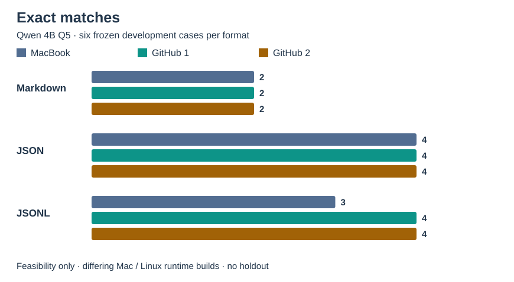
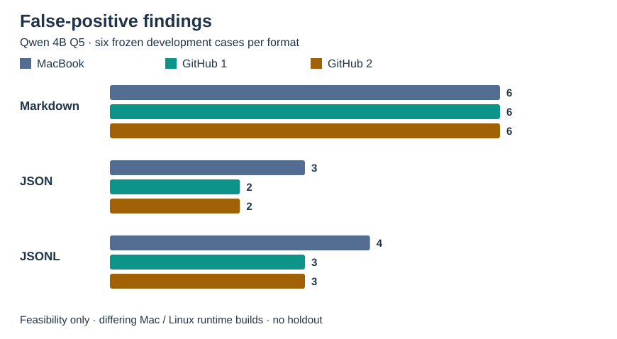
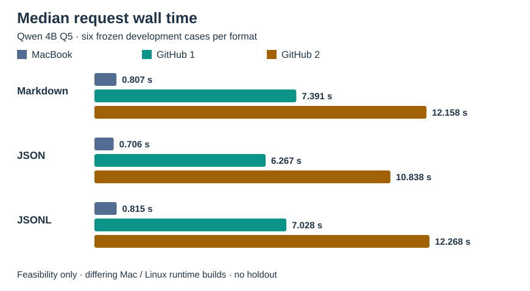

# R10-E01 — Hosted repeatability evidence

**27 November 2026 · Run #45983657043 · Feasibility only**

[Run 2](https://github.com/edh-project/edh-adr-preflight/actions/runs/45983657043) · [Run 1](https://github.com/edh-project/edh-adr-preflight/actions/runs/45980022896) · [First evidence](../first-hosted/README.md) · [Research report](../../engineering-research-report.md)

All nine expected artifact files were downloaded. Manifest hashes and SVG XML parsed successfully. Frozen dataset matches both earlier runs. Across 18 matching case/format pairs, the two hosted runs returned identical sets of validated findings (18/18), including identical incorrect findings. This is repeatability on a development corpus, not correctness or population-level determinism.

| Format | Exact Mac / H1 / H2 | FP Mac / H1 / H2 | Median request seconds Mac / H1 / H2 |
|---|---:|---:|---:|
| Markdown | 2 / 2 / 2 | 6 / 6 / 6 | 0.807 / 7.391 / 12.158 |
| JSON | 4 / 4 / 4 | 3 / 2 / 2 | 0.706 / 6.267 / 10.838 |
| JSONL | 3 / 4 / 4 | 4 / 3 / 3 | 0.815 / 7.028 / 12.268 |

All three runs: 18/18 valid, TP=15, FN=0. Hosted exact=10/18, FP=11 in both runs. Overall hosted elapsed 155 and 241 seconds. Median request time rose 1.64–1.75x; physical processor identity was not captured, so causes are unknown.

[Minimized machine-readable evidence](evidence.json) records 18 trial rows and original hashes; not byte-identical to raw artifacts. No energy, memory or cost saving measured. No paid or external mode executed.
