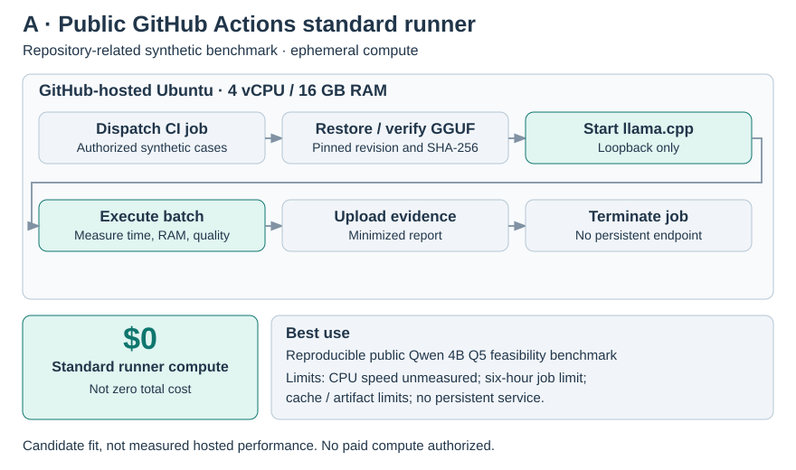
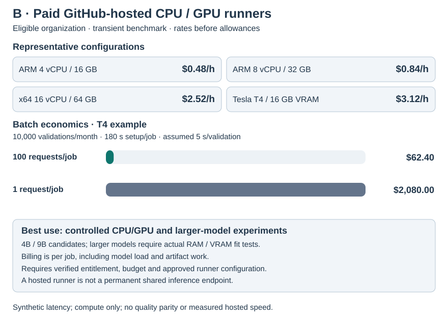
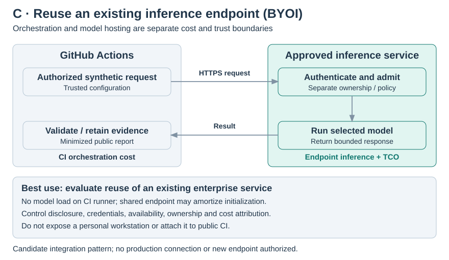

# R10-B — GitHub-hosted inference economics and feasibility

**Evidence Freeze · 27 November 2026 · Cost scenario, not measured hosted performance**

This note does not introduce a new research direction or authorize paid compute. It evaluates a third execution environment for the existing R10 experiment: a transient GitHub Actions job, with the same pinned GGUF weights and a loopback llama.cpp process. The existing BYOI adapter remains an alternative to in-job inference.

## 1. Measured input from the local feasibility run

Mac14,6; localhost qwen4b endpoint (reported 4,205,751,296 parameters, 3,239,901,184 bytes, Q5_K - Medium, 8,192 context, one slot). 18 calls, six reused synthetic development cases, one repeat per input representation, temperature 0, seed 42, common JSON-schema output request, thinking disabled, cache_prompt false requested. Server enforcement of all requested parameters was not independently confirmed.

| Input | Valid | Exact | TP | FP | FN | Median wall seconds | Median prompt tokens | Median total tokens |
| --- | ---: | ---: | ---: | ---: | ---: | ---: | ---: | ---: |
| Markdown | 6/6 | 2/6 | 5 | 6 | 0 | 0.8069245 | 175.5 | 206.5 |
| JSON | 6/6 | 4/6 | 5 | 3 | 0 | 0.70625 | 190.5 | 215 |
| JSONL | 6/6 | 3/6 | 5 | 4 | 0 | 0.814901 | 195.5 | 225 |

Dataset SHA-256: `5231e42696e265c6b067ef3c37746c73732286473a7ba192fd8e59974026ad92`. Probe SHA-256: `37bd80aa148a7b3ce3cf8459d7e7cad0456de23f61c3ef487faf63535d088440`. Local summary read back after completion. The current endpoint identity was verified via its API, not a fresh hash of the loaded model file. Raw evidence and script remain local; this table is a summary, not a fully published reproduction package.

The pilot is not an independent holdout, does not measure energy, and cannot establish format superiority or estimate GitHub-hosted latency. False positives remain substantial. No preflight authority or production readiness is implied.

## 2. GitHub infrastructure options

Official rate-card snapshot as reviewed on 27 November 2026. Rates below are USD per billable minute, before included allowances, storage, tax or subscription fees. Public standard hosted runners are free for repository-related CI subject to GitHub terms and limits. Larger runners require an eligible Team/Enterprise Cloud organization and are metered even for public repositories; eligible included value may offset charges.

| Runner | RAM / VRAM | Rate/min | Rate/hour | Candidate |
| --- | --- | ---: | ---: | --- |
| Public Ubuntu standard x64/arm64, 4 vCPU | 16 GB RAM, CPU | 0 | 0 | Qwen 4B Q5; measure CPU speed |
| Private Ubuntu standard x64, 2 vCPU | 8 GB RAM | 0.006 | 0.36 | Qwen 4B, tighter memory budget |
| Private Ubuntu standard arm64, 2 vCPU | 8 GB RAM | 0.005 | 0.30 | Qwen 4B, tighter memory budget |
| Larger ARM Linux 4 vCPU | 16 GB RAM | 0.008 | 0.48 | Qwen 4B |
| Larger ARM Linux 8 vCPU | 32 GB RAM | 0.014 | 0.84 | Potential 27–31B lower-bit CPU loading |
| Larger ARM Linux 16 vCPU | 64 GB RAM | 0.026 | 1.56 | Potential 27–31B CPU evaluation |
| Larger x64 Linux 16 vCPU | 64 GB RAM | 0.042 | 2.52 | Potential 27–31B CPU evaluation |
| Linux GPU runner, Tesla T4 | 28 GB RAM / 16 GB VRAM | 0.052 | 3.12 | Qwen 4B full offload candidate; larger models may require partial offload |

Sources: [runner rates](https://docs.github.com/en/billing/reference/actions-runner-pricing), [standard specs](https://docs.github.com/en/actions/reference/runners/github-hosted-runners), [larger specs](https://docs.github.com/en/actions/reference/runners/larger-runners), [job limits](https://docs.github.com/en/actions/reference/limits). Confirm organization entitlements, labels and final pricing before use. GPU VRAM is not additive to RAM for a full GPU-offload fit. Larger model fit depends on actual quantization, architecture, KV cache, context and runtime allocations; file size alone is insufficient. Qwen 27B and Gemma 31B are reference-model candidates, not validated GitHub deployments.

### 2.1 Three operating models at a glance

*Figure A. Zero standard-runner compute charge for permitted public repository CI, not zero TCO. Qwen 4B Q5 fit and CPU throughput remain to be measured.*

[Mermaid source](assets/21-github-standard-runner.mmd)

*Figure B. Published list rates before included value and other charges. Batch comparison uses synthetic latency from Section 3. Confirm actual eligibility and billing; no paid job is authorized.*

[Mermaid source](assets/22-github-paid-runner.mmd)

*Figure C. Separate CI orchestration and inference-host trust/cost boundaries. BYOI adapter exists; integration with any particular enterprise endpoint is unverified.*

[Mermaid source](assets/23-github-byoi.mmd)

| Decision dimension | A — Public standard | B — Paid hosted | C — BYOI |
| --- | --- | --- | --- |
| Runner compute | USD 0 for eligible public CI | Metered, before included value | Depends on orchestration runner |
| Inference compute | Within job | Within job | Separate endpoint |
| Reproduction control | Pinned in-job environment; cold starts | Pinned in-job environment; hardware choice | Requires pinned endpoint identity and independent evidence |
| Primary purpose | Public synthetic feasibility | Controlled hardware/quantization experiments | Reuse existing approved service |
| Principal constraint | Ephemeral, CPU and storage limits | Entitlement, budget, ephemeral lifecycle | Ownership, disclosure, availability and cost allocation |
| Readiness | Hosted benchmark not run | Not run; no paid authorization | Adapter implemented; target service not validated |

All three are execution-environment alternatives for the same research, not different quality guarantees. Compare measured correct-resolution cost at comparable risk, not just runner charges.

## 3. Batch cost model

For N validations per month, batch size B, startup time s seconds (download/cache restore, runtime initialization, model loading, tests and artifact overhead), mean incremental latency t seconds per validation, and rate r per billed minute:

$
J=\left\lceil\frac{N}{B}\right\rceil,\qquad C=r\sum_{j=1}^{J}\left\lceil\frac{s+b_jt}{60}\right\rceil
$

Here $b_j$ is the actual batch size of job $j$, including the final partial batch. [Editable LaTeX source](assets/github-batch-cost-equations.tex).

Assume 10,000 validations/month, 100 per job, 180 seconds of setup/job, sequential calls, one attempt. No private allowances applied. Hypothetical t values are sensitivity inputs, not hosted measurements. The same latency across runner rows isolates price effects, not hardware performance.

| Runner | 5 s/validation (1,200 min) | 15 s/validation (2,800 min) | 60 s/validation (10,300 min) |
| --- | ---: | ---: | ---: |
| Public standard | $0 | $0 | $0 |
| Private arm64 standard | $6.00 | $14.00 | $51.50 |
| Private x64 standard | $7.20 | $16.80 | $61.80 |
| Larger ARM 4 vCPU | $9.60 | $22.40 | $82.40 |
| Larger ARM 8 vCPU | $16.80 | $39.20 | $144.20 |
| Larger ARM 16 vCPU | $31.20 | $72.80 | $267.80 |
| Larger x64 16 vCPU | $50.40 | $117.60 | $432.60 |
| Linux GPU T4 | $62.40 | $145.60 | $535.60 |

For the same 10,000 requests with a separate job per request, 180 seconds setup + 5 seconds inference rounds to four minutes, or 40,000 minutes/month: private x64 standard $240, T4 $2,080. Batching can be decisive. Queue time and cold/warm latency should be reported separately. Do not extrapolate the local Mac's approximately 0.7–0.8 seconds to CPU runners.

These are compute costs only. For a quality-matched service add retries, escalation, cache/storage, operations, mandatory review and failure/rework. Cost per correctly resolved validation is total attributable cost divided by the number of independently correct resolutions. A free CI job is not a zero-TCO enterprise service.

## 4. Reuse and operating modes

- **In-job inference:** download or restore a pinned public model artifact, verify SHA-256, start llama.cpp bound to loopback, run an authorized synthetic batch, upload minimized evidence, terminate with the job. No exposed inference service, no model weight committed to Git. Benchmark x64 and ARM separately.
- **Reuse existing inference service (BYOI):** GitHub Actions sends approved payloads to a trusted, separately hosted endpoint. GitHub compute charges cover orchestration; inference host costs and disclosure controls are separate. Do not expose a personal workstation or connect an everyday Mac as a public self-hosted runner.
- **Persistent/shared endpoint:** an external managed or isolated self-hosted service can amortize model loading over many callers. A GitHub-hosted runner is ephemeral and subject to a six-hour job limit; it is not a persistent inference hosting product.

A 3.24 GB weight file fits within the nominal 10 GB included Actions cache budget if other cache use permits. Cache restoration, eviction and model downloads are not free in elapsed time. Larger weights should not be stored as public workflow artifacts or committed to the repository. Use immutable model revisions and verify checksums. [Cache limits and billing](https://docs.github.com/en/actions/reference/limits), [dependency caching](https://docs.github.com/en/actions/reference/workflows-and-actions/dependency-caching).

GitHub Models' former inference API was retired on 30 July 2026 ([official notice](https://docs.github.com/en/github-models)); it is not a route for deploying arbitrary GGUF weights.

## 5. Next evidence gate

Run a manually dispatched, time-bounded standard public Ubuntu CPU benchmark for the repository's synthetic research workload only. Pin exact model artifact and llama.cpp revision; compare against local configuration, record setup/load/inference wall time, memory, tokens, quality, runner image and hardware. Capture both cold and warm runs. No paid runner or external endpoint exposure authorized by this note. A larger-model benchmark requires verified artifacts and separate resource/entitlement assessment.

**Status:** local feasibility run completed; GitHub hosted inference not yet executed; costs hypothetical. Do not use this document to claim a measured saving or select production infrastructure.
