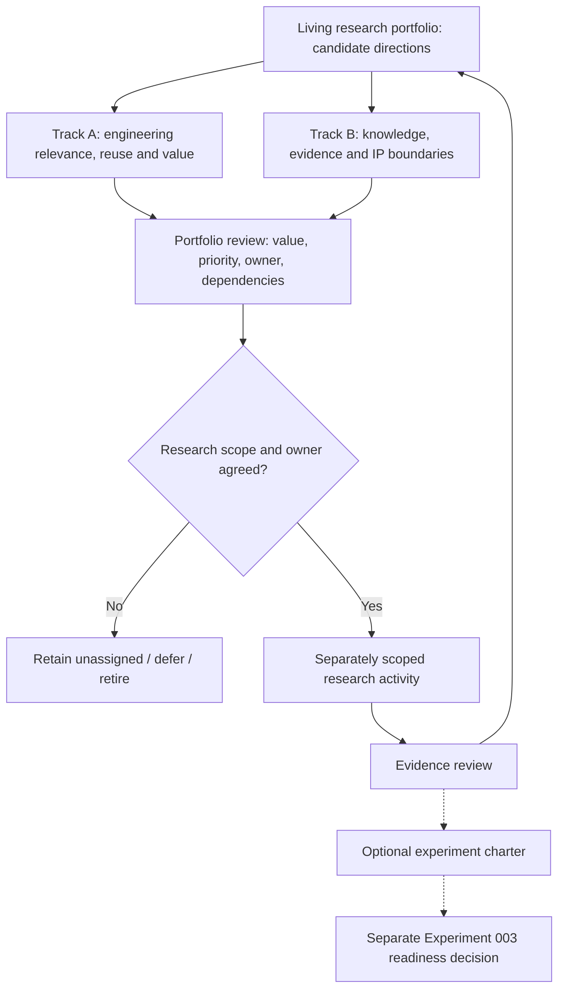

# A-SDLC Research Portfolio — Living Research Directions Register

**Status:** proposed research portfolio / unprioritized / documentation only  
**Initial review:** 25 November 2026  
**Portfolio steward:** unassigned  
**Next review:** during Experiment 003 elaboration, subject to availability and approval.

## Purpose and scope

Maintain a single evolving register of independent research directions beyond reliance on frontier model providers. This is an organizing document referenced by Experiment 003, not another experiment, implementation roadmap, product selection or commitment. The directions may be added, merged, split, reprioritized, deferred or retired as evidence and organizational needs evolve.

Experiment 003 remains the framework for engineering alignment and knowledge/IP governance. The portfolio provides candidate questions for those workstreams. It does not establish a gap in any organization or authorize research using its internal information.

## Initial research directions

The IDs are stable register identifiers, not experiment numbers, rankings or a delivery sequence. Each value proposition below is a hypothesis; no comparative assessment has yet been made. The interoperability topic is separated from harness engineering because cross-system compatibility and portability warrant an independent decision.

| ID | Research direction | Scope / question | Potential value to investigate |
|---|---|---|---|
| R01 | Specification-Driven Architecture | Connect requirements, ADRs, constraints, acceptance criteria and executable specifications; investigate change propagation and consistency. | Less architectural drift and rework; traceable design intent before code. |
| R02 | Independent Verification & Software Factory | Explore independent behavioral scenarios, holdout tests, simulated dependencies and separation of implementation from verification. | Stronger acceptance evidence and reduced risk of agents validating their own mistakes. |
| R03 | Model-Agnostic Harness Engineering | Explore execution environments, bounded tools, durable workflows, checkpointing, recovery and model substitution. | More reliable execution without unnecessary dependency on one model or runtime. |
| R04 | Enterprise Context Engineering | Explore context discovery, provenance, freshness, relevance, access and cost across engineering knowledge. | Less context-search overhead and better grounded architectural and delivery decisions. |
| R05 | Verifiable Execution & Evidence Engineering | Explore linking intent, policy, approval, execution, verification and delivery evidence; reuse existing attestations and telemetry. | Improved control, accountability, reporting and diagnostic traceability. |
| R06 | Empirical A-SDLC Productivity | Explore defensible baselines, matched workloads, quality, review effort, rework, latency, cost and operational impact. | Evidence of actual engineering value rather than activity or generated-code volume. |
| R07 | Open Standards & Interoperability | Explore portable contracts, tool and agent interfaces, event/evidence conventions, compatibility and reuse across existing platforms. | Reduced integration friction and vendor lock-in; narrower replaceable boundaries. |

No vendors, frameworks or tools are selected by this register. A detailed literature and alternatives review belongs to a later, separately scoped research activity.

## Current portfolio register

| ID | Value assessment | Priority | Accountable research owner | State | Next review action |
|---|---|---|---|---|---|
| R01 | Unassessed | TBD | Unassigned | Candidate | Clarify specification/ADR research question. |
| R02 | Unassessed | TBD | Unassigned | Candidate | Define independent verification question. |
| R03 | Unassessed | TBD | Unassigned | Candidate | Map existing harness capabilities and alternatives. |
| R04 | Unassessed | TBD | Unassigned | Candidate | Define context quality and provenance question. |
| R05 | Unassessed | TBD | Unassigned | Candidate | Identify evidence correlation and reuse questions. |
| R06 | Unassessed | TBD | Unassigned | Candidate | Define comparison and baseline requirements. |
| R07 | Unassessed | TBD | Unassigned | Candidate | Identify relevant interface and interoperability questions. |

All entries are intentionally unranked and unassigned. No actual organizational staffing, budget, access or owner commitment is assumed.

## Portfolio maintenance and prioritization

For each direction, assess relevance to agreed objectives, demonstrated need, existing/planned alternatives, expected benefit, evidence confidence, feasibility, effort, operational burden, dependencies and security/IP constraints. Record a brief rationale and review date alongside changes to value, priority and ownership. Unknown evidence remains unknown; do not treat it as zero value or a confirmed gap.

Suggested priority vocabulary: **P0** immediate research needed for an approved decision; **P1** next research candidate; **P2** useful but non-blocking; **P3** watchlist; **TBD** not assessed. Priority is not implementation authority. An accountable research owner must accept the role before active research starts. Contributors and reviewers may be recorded as needed. Public entries must not identify organizational participants without authorization.

Suggested lifecycle: Candidate → Scoped → Active research → Evidence review → Retain / Reprioritize / Merge / Split / Defer / Retire. A retained direction may propose a distinct experiment charter; only an explicit readiness decision under Experiment 003 authorizes a separately scoped implementation.

## Relationships to Experiment 003

- [Integrated Engineering and Knowledge Governance Framework](Experiment-003-Integrated-Engineering-and-Knowledge-Governance.md): governs the portfolio's organizational fit and readiness decisions.
- [Track A — Engineering Alignment](Experiment-003-A-SDLC-Organizational-Alignment.md): evaluates relevance, reuse, dependencies, expected outcomes and evidence quality.
- [Track B — Knowledge & IP Governance](Experiment-003-Demonstration-and-Disclosure-Boundaries.md): governs permitted research material, disclosure and use; organization-specific conclusions remain in approved restricted/internal context.

Portfolio reviews may happen during the existing elaboration window or when new evidence changes a decision. No fixed implementation dates are attached to these directions.

## Change record

| Date | Change | Rationale |
|---|---|---|
| 25 November 2026 | Initial seven candidate directions; all value assessments, priorities and owners pending. | Organize future inquiry without presupposing organizational gaps, technology choice or implementation scope. |

Use versioned updates to preserve decision history. Public register entries describe generic directions and approved non-identifying information only; organization-specific prioritization, evidence, identities and detailed conclusions remain in the appropriate approved environment.
