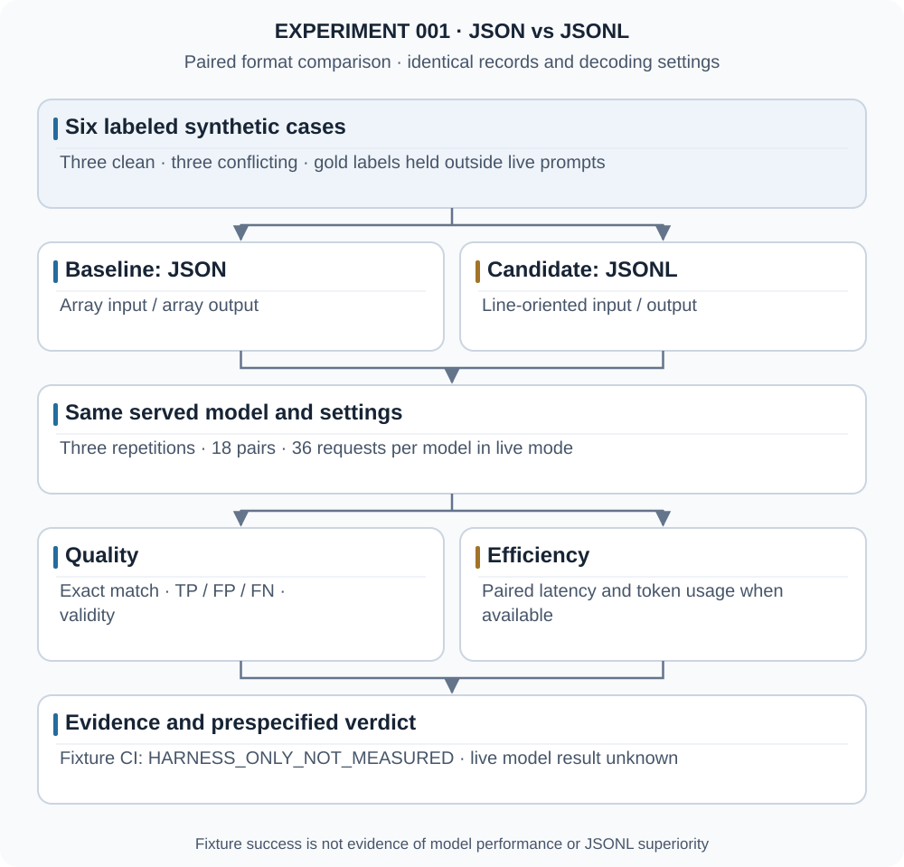

# Experiment 001 — JSON vs JSONL for small local models

**Status:** fixture CI passed and the measured local pilot completed 108 requests across Qwen 4B, Qwen 27B, and Gemma 31B. Each profile reported `PILOT_INCONCLUSIVE`. See the [measured results](../evidence/qwen4b-json-jsonl-pilot-2026-11-26.md#measured-local-comparison). Independent corpus replication and profile acceptance remain open.

## Fixture checkpoint — 2026-11-25

The benchmark implementation is in [draft PR #2](https://github.com/edh-project/edh-adr-preflight/pull/2), with the original experiment commit [2c7d926](https://github.com/edh-project/edh-adr-preflight/commit/2c7d926be487bcbd4fe16c7afae32015981832e4). The main branch remains unchanged by this experiment.

| Component | Status / evidence |
|---|---|
| Deterministic PR rejection | [PR #1 structural check](https://github.com/edh-project/edh-adr-preflight/actions/runs/45569140916): expected failure, independent of inference |
| Existing BYOI adapter | [Regression CI](https://github.com/edh-project/edh-adr-preflight/actions/runs/45570202159): passed |
| Paired benchmark harness | [Benchmark CI](https://github.com/edh-project/edh-adr-preflight/actions/runs/45571575915): passed |
| Unit tests | 24/24 passed in benchmark job logs |
| Fixture experiment | Six cases × three repetitions × two arms = 36 oracle-stub trials; harness passed |
| Evidence | [Fixture artifact](https://github.com/edh-project/edh-adr-preflight/actions/runs/45571575915/artifacts/15002341583) uploaded; ZIP contains the intended trial, comparison and summary outputs |
| Live inference | Skipped intentionally on PR; zero measured model requests in this CI run |
| Verdict | HARNESS_ONLY_NOT_MEASURED |

The hosted fixture run verified harness execution. Live findings are recorded separately. The benchmark has no execution authorization.

## Next steps and acceptance gates

- [x] **P0 — Local execution:** check out PR #2 on a trusted workstation; verify the served model ID and endpoint with /v1/models. Choose a small model (initial candidate: Qwen 4B, exact build and quantization to be recorded). Record hardware, server version, context length, inference settings and cache/warm-up state. Do not attach a personal runner to the public repository.
- [x] **P0 — First measured pair:** execute three repetitions for one model (36 actual requests), using identical settings in both arms. Preserve trials.jsonl, comparison.json and summary.md, including errors, invalid outputs and unavailable token counts. Check that all 18 pairs are represented; do not substitute fixture results for live trials.
- [x] **P0 — Review evidence:** compare exact matches, valid responses, TP/FP/FN, precision/recall and paired latency/token deltas; examine invalid or truncated outputs and verify findings against the labeled records. Apply the prespecified verdict without changing the rule after viewing results. Document run configuration and limitations.
- [x] **P1 — Compare local profiles:** complete 36 live requests per profile on Qwen 4B and the two larger reference profiles, Qwen 27B and Gemma 31B. Keep per-model results separate.
- [ ] **P1 — Replicate on another small model:** repeat on a second small model, with its own endpoint, model ID, output directory and report. Do not pool model results. Optionally use a larger model as a reference, clearly labeled as such.
- [ ] **P1 — PR review and hosted reproducibility:** review tests and security boundaries, then merge only when approved. The manually dispatched live GitHub Action is intentionally main-only; until merge, use the local CLI from the experiment branch. Hosted execution requires a reachable HTTPS inference service configured by the operator, not workstation localhost.
- [ ] **P2 — Isolate the effect:** add a 2×2 ablation (JSON/JSONL input crossed with JSON/JSONL output), a schema-constrained JSON baseline, and a larger independently labeled held-out ADR/code corpus. Keep sample selection and evaluation rules fixed before runs.
- [ ] **P2 — Strengthen measurement:** repeat on independent samples, quantify uncertainty and caching/order effects, then study streaming/time-to-first-finding separately. Decide whether to integrate the winning format into ADR preflight only after reviewing evidence; do not change runtime admission semantics based on this pilot.

**Exit criterion for the first live milestone:** a reproducible evidence bundle for at least one small model, a recorded configuration, complete pair accounting and a justified verdict (including inconclusive or regression). No requirement that JSONL wins.

## Research question

Does representing the same ADR/code evidence and findings as JSON Lines improve validation reliability or resource efficiency on small self-hosted models compared with ordinary JSON? Motivation: observed benefits on larger Qwen models; transfer to small models is unknown.

## Experimental design



*Visual overview. Fixture success is not evidence of model performance or JSONL superiority. The protocol below defines the comparison.*

| Factor | Baseline | Experimental |
|---|---|---|
| Input | JSON array of addressable records | JSONL, one identical record per line |
| Output | JSON array of finding records + completion | JSONL finding records + completion |
| Transport | OpenAI-compatible chat completions, non-streaming | Same |
| Model | Same exact served alias, quantization, server and settings | Same |
| Decoding | temperature 0, same max tokens; no grammar/schema forcing | Same |
| Evidence | same record IDs, text, gold pairs, validation rules | Same |

The experiment changes both input and output encoding as one intervention. It does not isolate which causes a difference; a later 2×2 design should separate them. It is not a comparison against the existing schema-constrained production-shaped adapter. No claim about streaming or time to first finding follows from this non-streaming pilot.

The six synthetic cases cover clean and conflicting ADR decisions and tiny code snippets (three negative and three positive cases). Gold labels are explicit pairs of candidate and constraint IDs, held outside model prompts. Record IDs and text are identical across arms. The cases are curated and small; generalization to full ADRs, real diffs and larger corpora requires a separate dataset. The benchmark does not execute code or grant admission.

## Protocol

1. Choose one small model and record exact GGUF filename/quantization, llama.cpp build, hardware, context settings and actual served model alias in a separate run note. Repeat independently for each model (e.g. Qwen 4B then a second small model). Do not pool different models.
2. Start one server; avoid concurrent inference. Warm up separately if desired, identically across experiments; note cache state. The harness uses a fixed shuffled case order and alternates JSON/JSONL first to reduce order bias. It does not control provider caching or temperature-zero nondeterminism.
3. Run at least three repetitions (36 requests per model; five gives 60). The same output limit applies to both arms. Record timeouts, invalid responses and missing usage; do not discard failures from accuracy.
4. Compare exact case match, schema/reference/completion validity, TP/FP/FN, precision and recall; compare paired median latency and provider-reported token deltas only where both outputs are valid and metrics exist. Record bytes and hashes as diagnostic evidence, not substitute token counts.
5. Missing completion, unknown IDs, duplicate findings or non-stop finish invalidate the response. Invalid trials cannot count as exact matches; gold violations are counted as missed. No automatic admission is possible.

## Initial evaluation approach

This is one evaluation approach trialed with Qwen 4B in Experiment 001. It turns observed failures into repeatable tests and records the conditions under which a model profile may be reused.

| Step | Record for reuse |
| --- | --- |
| Establish a baseline | Pin the evaluation code and labeled cases. Record the GGUF hash and quant, served alias, runtime build, chat template, prompt, response schema, decoding settings and cache state. Preserve each attempt and its outcome. |
| Diagnose failures | Record transport errors, truncation, output validation and semantic findings separately. Inspect saved responses on a small synthetic subset before repeating the full suite. |
| Add a regression | Preserve the original failure with the expected result. Add a matched compliant/violating case, then vary one setting at a time while holding the other settings fixed. |
| Retest and compare | Report valid and exact responses, FP and FN, and the denominator for every timing or token comparison. Use the same cases across the compared profiles. Validate on independently labeled cases before extending the profile's scope. |
| Record the workflow decision | Link the accepted or candidate profile to its evidence, intended role, known regressions and escalation rule. Check outcome quality and end-to-end cost before assigning the profile authority. |

The Qwen 4B run kept the initial failed pilot, repeated a clean-ADR false positive across output configurations, and compared a clarification of the prompt against matched wording. The subsequent thinking-disabled retest found better output validation with JSONL in that setup. Both formats still produced false positives. The observed configuration remains a first-pass review candidate with independent verification. [Live evidence and known regressions](../evidence/qwen4b-json-jsonl-pilot-2026-11-26.md)

### Local comparison matrix

| Model profile | Prior evidence | Role to evaluate |
| --- | --- | --- |
| Qwen 3.5 4B `UD-Q5_K_XL` | Paired JSON/JSONL retest and recorded false positives | First-pass reviewer |
| Qwen 3.8 27B `UD-Q5_K_XL` | [Live ADR matched-pair run](https://github.com/edh-project/edh-adr-preflight/blob/main/docs/evidence/adr-live-matched-pair.md) | Independent review of 4B findings |
| Gemma 4 31B `UD-Q4_K_XL` | [Live ADR matched-pair run](https://github.com/edh-project/edh-adr-preflight/blob/main/docs/evidence/adr-live-matched-pair.md) | Independent review from a different model family |
| Additional local Qwen versions or quants | Record the exact GGUF and SHA-256 when selecting each profile | Compare versions or compare quants within the same model release |

1. Use the same six labeled cases and the same held-out cases across profiles. Include the compliant patch-without-credentials and code-boundary failures in the regression set. Hold the output contract and settings fixed where the runtimes support them. Record the effective chat template and thinking behavior for each profile. Label any configuration that changes more than one factor as a profile comparison.
2. To measure quantization, compare distinct quants of the same model release under the same runtime and settings. Treat the Qwen 4B, Qwen 27B and Gemma 31B runs as different model profiles. Report validity, exact matches, FP/FN, latency, tokens and any missing measurements per profile.
3. Evaluate each potential second reviewer on the full labeled set, including cases where 4B returns no findings. Separately measure which 4B findings are confirmed or rejected, which missed findings are recovered, and the total latency and tokens if both stages run. Keep ADR approval outside this pilot.

### Run the comparison on a local Mac

Use a checkout of [Experiment 001](https://github.com/edh-project/edh-adr-preflight/pull/2) and the existing GGUFs. Use one `llama-server` process at a time on loopback, on the same Mac and runtime build. Run every profile against the same benchmark revision and case set. Start with one repetition per profile (12 requests each). The measured run uses three repetitions (36 requests per profile, 108 across the three profiles). Report smoke runs separately.

**Terminal 1. Start one model and record its provenance.** Select `qwen4b`, `qwen27b`, or `gemma31b`. The server remains in the foreground. Stop it with Ctrl-C before switching models.

```sh
edh_profile=qwen4b
edh_model=
case "$edh_profile" in
  qwen4b) edh_model="$HOME/models/Qwen3.5-4B/Qwen3.5-4B-UD-Q5_K_XL.gguf" ;;
  qwen27b) edh_model="$HOME/models/Qwen3.8-27B/Qwen3.8-27B-UD-Q5_K_XL.gguf" ;;
  gemma31b) edh_model="$HOME/models/Gemma4-31B/gemma-4-31B-it-qat-UD-Q4_K_XL.gguf" ;;
esac
if [ -f "$edh_model" ] && command -v llama-server >/dev/null &&
   mkdir -p "$HOME/WORK/_edh/edh-model-eval/runs" &&
   edh_run_dir=$(mktemp -d "$HOME/WORK/_edh/edh-model-eval/runs/$edh_profile.XXXXXX") &&
   shasum -a 256 "$edh_model" > "$edh_run_dir/model-sha256.txt" &&
   llama-server --version > "$edh_run_dir/runtime.txt" 2>&1 &&
   printf "%s\n" "$edh_profile" > "$edh_run_dir/model-alias.txt"; then
  printf "Run directory: %s\n" "$edh_run_dir"
  llama-server --model "$edh_model" --alias "$edh_profile" \
    --host 127.0.0.1 --port 8092 --ctx-size 8192 --parallel 1 --n-gpu-layers 99 \
    --reasoning off --no-cache-prompt 2>&1 | tee "$edh_run_dir/llama-server.log"
else
  printf '%s\n' 'Setup failed: check the GGUF, llama-server and report directory.' >&2
fi
```

Keep this launch command with the report. Record any runtime or `LLAMA_ARG_*` overrides. Use `--reasoning off` for all measured profiles. One earlier Qwen 4B smoke used the deprecated server flag `--chat-template-kwargs` and remains a separate smoke record. Smoke-check the effective template and whether the runtime still emits reasoning. Record differences as profile settings when templates behave differently. A shared flag value alone is insufficient to establish identical behavior.

**Terminal 2. Run the benchmark from the root of the Experiment 001 checkout.** Copy the run directory printed by Terminal 1. Keep the smoke and measured outputs in separate directories.

```sh
edh_run_dir="/paste/the/run/directory/here"
edh_repeats=1
edh_result="$edh_run_dir/results-r$edh_repeats"
if [ -r "$edh_run_dir/model-alias.txt" ] &&
   [ -f benchmark_jsonl.py ] &&
   [ ! -e "$edh_result" ] &&
   edh_alias=$(cat "$edh_run_dir/model-alias.txt") &&
   curl --noproxy '*' -fsS --max-time 5 http://127.0.0.1:8092/v1/models -o "$edh_run_dir/served-models.json" &&
   python3 -c 'import json, sys; data=json.load(open(sys.argv[1])); sys.exit(not any(m["id"] == sys.argv[2] for m in data["data"]))' "$edh_run_dir/served-models.json" "$edh_alias" &&
   mkdir "$edh_result" && git rev-parse HEAD > "$edh_result/benchmark-revision.txt"; then
  env -u ADR_PRIMARY_API_KEY ADR_ENDPOINT_POLICY=loopback-only ADR_TIMEOUT_SECONDS=180 \
    ADR_PRIMARY_URL=http://127.0.0.1:8092/v1 ADR_PRIMARY_MODEL="$edh_alias" \
    python3 benchmark_jsonl.py --mode live --repeats "$edh_repeats" --max-tokens 1024 \
      --output "$edh_result"
  edh_status=$?
  printf 'Benchmark exit status: %s\n' "$edh_status"
else
  printf '%s\n' 'Setup failed: check the run directory, served alias and output path.' >&2
fi
```

Use `edh_repeats=3` for the measured run. Exit status 1 with `comparison.json` can indicate rejected responses. Retain and report those rows. If a run cannot write the comparison, preserve the partial log and use a fresh directory for the retry.

For each profile retain `trials.jsonl`, `comparison.json`, `summary.md`, the GGUF SHA-256, server version, served model, benchmark revision and launch settings. Compare output validity and semantic accuracy separately. Include model load time separately from request latency when estimating local workflow cost. A measured profile may use a different chat template or quant, so label the comparison accordingly.

**Evaluate the cascade after the independent runs.** Match results by case, repetition and format. Compare 4B alone with 27B alone and Gemma alone before applying a predeclared routing rule to the saved rows. Count 4B findings the second model confirms or rejects and violations the second model recovers on cases where 4B returned nothing. Report the second-stage call rate and summed latency and tokens. Treat failed or invalid responses as unresolved. The simulated cascade reuses independent results. Its estimates need a separate end-to-end run for any workflow that passes the first model's findings into the second model's prompt.

## Deployment-rule regression and response contract

The actor probe found a shared false positive on an approved pipeline call. The regression checks evaluate two independent facts: the verified deployment executor and whether required approval was verified. Pipeline and agent calls are tested with and without approval. An unknown executor or approval produces an unresolved result for that rule.

Replay the measured logs from this checkout:

```sh
edh_runs="$HOME/WORK/_edh/edh-model-eval/runs"
python3 review_validation.py replay \
  "$edh_runs/qwen4b.measured.b2XgGa/results-r3/trials.jsonl" \
  "$edh_runs/qwen27b.measured.dJBUVz/results-r3/trials.jsonl" \
  "$edh_runs/gemma31b.measured.AGCWNS/results-r3/trials.jsonl"
```

Replay checks the case identifier and the exact record-set SHA-256 before suppressing findings contradicted by known facts on the approved synthetic pipeline call. It reports precision inputs and exact-match counts before and after, separately by model and format. Other cases and output validity retain their measured results. The pilot files supply the baseline and are opened read-only. A real CI integration requires a trusted source that resolves the execution identity and approval evidence.

### Replay results on all 108 saved requests

| Model | Format | Valid | FP before → after | Exact before → after | TP / FN retained |
| --- | --- | ---: | ---: | ---: | ---: |
| Qwen 4B | JSON | 12/18 | 12 → 6 | 3 → 6 | 9 / 6 |
| Qwen 4B | JSONL | 18/18 | 12 → 6 | 9 → 12 | 15 / 0 |
| Qwen 27B | JSON | 18/18 | 3 → 0 | 15 → 18 | 15 / 0 |
| Qwen 27B | JSONL | 18/18 | 3 → 0 | 15 → 18 | 15 / 0 |
| Gemma 31B | JSON | 0/18 | 0 → 0 | 0 → 0 | 0 / 15 |
| Gemma 31B | JSONL | 18/18 | 3 → 0 | 15 → 18 | 15 / 0 |

Replay changed three responses per affected model and format. At each appearance of the approved synthetic call, it removed the findings contradicted by the verified facts. All true-positive and false-negative counts were retained. The scope is the original pinned fixture; coverage on unseen cases and trusted real-workflow identity and approval evidence remain open. Gemma JSON responses still fail the benchmark's strict format check.

### Live JSON Schema contract probe

This separate check uses the existing live preflight request and findings validator against one model at a time. Every model reviews the same two proposed ADRs against the accepted baseline:

| Request | Scenario | What to look for |
| --- | --- | --- |
| `clean` (`ADR-0002`) | The agent returns a patch. The pipeline can deploy after human approval. | No spurious deployment or credential conflict. |
| `conflict` (`ADR-0003`) | The agent receives production credentials and can deploy directly without human approval. | Findings should identify those conflicts and quote relevant evidence. |

Each run is **two inference requests for one model**. Testing all three models once is **six requests**. The probe uses the existing findings-only JSON Schema for every request.

**Terminal 1 — serve one model.** Paste the function definition when the shell prompt is visible. Run `edh_serve gemma31b` and wait for `listening`. If Gemma already listens on `127.0.0.1:8092` with these settings, start with Terminal 2. After that first probe, stop the server with Ctrl+C and paste the function before starting Qwen 27B.

```sh
edh_serve() {
  local edh_alias="$1" edh_gguf
  case "$edh_alias" in
    gemma31b) edh_gguf="$HOME/models/Gemma4-31B/gemma-4-31B-it-qat-UD-Q4_K_XL.gguf" ;;
    qwen27b) edh_gguf="$HOME/models/Qwen3.8-27B/Qwen3.8-27B-UD-Q5_K_XL.gguf" ;;
    qwen4b) edh_gguf="$HOME/models/Qwen3.5-4B/Qwen3.5-4B-UD-Q5_K_XL.gguf" ;;
    *) printf 'Unknown model: %s\n' "$edh_alias" >&2; return ;;
  esac
  llama-server --model "$edh_gguf" --alias "$edh_alias" \
    --host 127.0.0.1 --port 8092 --ctx-size 8192 --parallel 1 \
    --n-gpu-layers 99 --reasoning off --no-cache-prompt
}
```

**Terminal 2 — check the active model.** These commands assume the PR #8 checkout used for replay is at `~/WORK/_edh/edh-deployment-review`. Paste this block once. It prints a JSON report and gives each run a fresh output directory.

```sh
edh_check_schema() {
  local edh_root="$HOME/WORK/_edh/edh-model-eval/schema-probes"
  local edh_out edh_status=0
  if mkdir -p "$edh_root" && edh_out=$(mktemp -d "$edh_root/$1.XXXXXX"); then
    python3 "$HOME/WORK/_edh/edh-deployment-review/review_validation.py" probe "$1" \
      > "$edh_out/probe.json" || edh_status=$?
    cat "$edh_out/probe.json"
    printf '\nExit status: %s\nReport: %s\n' "$edh_status" "$edh_out/probe.json"
  fi
}
edh_check_schema gemma31b
```

When the probe finishes, return to Terminal 1. Press Ctrl+C and run the next `edh_serve` command. Wait for `listening`, then run the matching command in Terminal 2.

| Terminal 1 | Terminal 2 |
| --- | --- |
| `edh_serve qwen27b` | `edh_check_schema qwen27b` |
| `edh_serve qwen4b` | `edh_check_schema qwen4b` |

Read the two rows in `probe.json`. A row with `valid: true` passed the live response contract, including quote validation. Check `findings` independently: a valid empty array on the conflicting ADR is a missed conflict. The probe exits with status 0 when both rows pass validation and 1 when at least one fails. A setup error exits with status 2.

#### Initial live run and request fix

All six responses from the first schema probe failed with the old request shape. The active Gemma and Qwen 27B models reported the expected aliases and returned parseable JSON, which the findings validator rejected. Qwen 4B failed at JSON decoding. An earlier Qwen 27B attempt ended with two HTTP errors and is recorded separately from the six responses.

For the measured runtime (build 10621, commit `c1d0e7a00`), [the server implementation](https://github.com/ggml-org/llama.cpp/blob/c1d0e7a00/tools/server/server-common.cpp) reads the constrained schema from `response_format.json_schema.schema` when the type is `json_schema`. The original request placed the schema directly under `response_format`. Preflight now sends the nested wrapper and the probe reports the failure stage, HTTP status or JSON error location where applicable. The initial observations remain the baseline for a new two-case probe per model.

#### Qwen 4B retest with the corrected request

Run `qwen4b.SUGjub` used client revision `bb28d238660efe744ecce59c8f647f07abded298`. Both completions reported the requested alias and finished with `stop`. Both decoded as JSON. The complete request-and-validation path accepted **1 of 2** responses, compared with **0 of 2** for this model before the request fix.

| Case | Accepted | Review observation |
| --- | --- | --- |
| `ADR-0002` (clean) | No | `review_validation` rejected an ungrounded evidence quote. The probe does not retain the rejected quote. |
| `ADR-0003` (conflict) | Yes | The response identified production credentials and direct deployment without human approval. It also cited direct deployment again and flagged latency and rollback statements that do not directly contradict the accepted ADR. |

The conflicting response shows why an exact source quote is a separate check from whether the finding follows from the text.

#### Complete three-model retest with the corrected request

All six completions reported the requested alias, ended with `stop`, and decoded as JSON. Five passed the full findings validator, compared with zero before the request fix.

| Local model and run | Clean ADR | Conflicting ADR | Accepted |
| --- | --- | --- | ---: |
| Qwen 4B · `qwen4b.SUGjub` | Rejected: ungrounded quote | Accepted, four findings | 1/2 |
| Qwen 27B · `qwen27b.zsc3FL` | Accepted, three warnings | Accepted, three findings | 2/2 |
| Gemma 31B · `gemma31b.E584r9` | Accepted, two findings | Accepted, two findings | 2/2 |

All three models identified the core violation in `ADR-0003`: the proposal gives the agent production credentials and allows direct deployment without human approval. The local validator checked the exact source quotes. The models sometimes repeated the same violation or inferred concerns beyond the cited policy.

On `ADR-0002`, Qwen 27B and Gemma both flagged an underspecified patch handoff. The ADR permits a patch and requires human approval before the pipeline acquires credentials, but gives little detail about how the reviewed patch reaches the pipeline. This is a proposed improvement to the ADR. Gemma's critical ambiguity around read-only access does not establish a direct violation: an agent can return a patch without writing to the source repository. These two ADRs form a live contract check. The run has insufficient breadth for model ranking or precision and recall estimates.

## Prespecified interpretation

Fixture runs always report HARNESS_ONLY_NOT_MEASURED: the stub is given gold labels to test the pipeline, not model ability. Timing and token metrics are absent, not zero. A live run is inconclusive by default. With at least three repetitions and all paired outputs valid, a JSONL quality regression is flagged if exact matches decrease or FP/FN increase. Otherwise JSONL is marked promising (not proven) only if exact matches do not decrease, FP/FN do not increase, and median latency or total tokens improves on all measured pairs. No statistical significance or general superiority is claimed. The pilot must be repeated on a larger independent corpus before an adoption decision.

## Reproduce

From the repository root on a trusted local host:

```sh
python3 benchmark_jsonl.py --mode fixture --repeats 3 --output reports/jsonl-fixture
```

```sh
export ADR_PRIMARY_URL=http://127.0.0.1:8080/v1
export ADR_PRIMARY_MODEL='REPLACE_WITH_SERVED_ALIAS'
export ADR_TIMEOUT_SECONDS=180
python3 benchmark_jsonl.py --mode live --repeats 3 --output reports/jsonl-qwen
```

Use any configured loopback address and port (including 8081 for a second model). For remote inference, use ADR_ENDPOINT_POLICY=https-only with an operator-configured HTTPS endpoint. Set ADR_PRIMARY_API_KEY securely if required, never commit it. The GitHub-hosted manual workflow uses repository Variables and Secrets on main only. PRs run both arms with an oracle stub and no secrets or external inference. Never connect a personal self-hosted runner to the public repository.

## Evidence artifacts

- trials.jsonl: one record per arm/case/repetition, gold and validated finding pairs, finish status, validity, score, provider token usage when available, elapsed time, input/output bytes and hashes. Raw model text is deliberately not published.
- comparison.json: aggregate quality, paired resource deltas, dataset/benchmark hashes, descriptive verdict.
- summary.md: human-readable comparison and explicit limitations.

Remaining work includes replication, 2×2 input/output ablation, a larger held-out corpus, streaming and constrained decoding. ADR approval remains a separate workflow decision.
