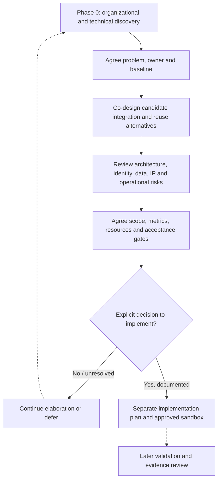

# Experiment 002 — Elaboration and Decision Gates

**Status: ELABORATION / NOT AUTHORIZED FOR IMPLEMENTATION.** Proposed public planning artifact, 25 November 2026. No actual organizational assessment, provider selection, implementation approval, delivery commitment or commercial agreement.

## Intent and hypotheses

Explore whether a portable architecture-to-execution governance capability can help an engineering organization deliver agent-assisted changes with less rework and stronger evidence of authorization and verification. Preserve the public ADR Preflight as a standalone component; any external runtime provider, including EDH, remains optional and separately evaluated.

| Hypothesis | Decision-relevant question | Candidate evidence |
|---|---|---|
| H1: organizational fit | Does the proposal address a prioritized team and broader-unit objective? | Agreed problem statement, owner and baseline. |
| H2: technical fit | Can existing platform interfaces be reused without duplicating governance or changing authority? | Reviewed current/target flows and gap analysis. |
| H3: operational value | Can a bounded integration reduce review/rework or improve traceability at acceptable cost? | Paired pilot evidence and resource accounting. |
| H4: portability | Can the preflight, orchestration and provider boundaries evolve independently? | Later contract/parity tests against a mock and an approved alternative. |
| H5: governance | Can unauthorized operations be prevented while valid work remains usable? | Later negative-path tests, explicit approval and independent verification evidence. |

## Elaboration workflow

The implementation gate is not satisfied by publication of this document, a calendar date, a successful fixture CI run, a model recommendation or the existence of a private provider.

## Required outputs before implementation

| Artifact | Required content | Proposed accountable perspective |
|---|---|---|
| Problem brief | Objective hierarchy, affected workflow, observed friction, current baseline, non-goals | Team/group owner |
| Capability and resource map | Reusable services, actual interfaces, owners, capacity, access and restrictions | Platform/inference owners |
| Architecture option record | Current and proposed flows, alternatives including no change, dependency and trust boundaries | Staff/architect |
| Experiment charter | Hypotheses, comparison plan, sample selection, agreed targets, budget and stopping rules | Experiment owner with reviewers |
| Security and data assessment | Authority, identity, tenant/data boundaries, logging, failure/revocation semantics and approved environment | Security and platform owners |
| IP and delivery assessment | Existing IP, licenses, approved distribution and rights, ownership/support responsibilities | Appropriate authorized parties |
| Decision record | Proceed/revise/defer/stop; approved scope, accountable owner, open risks and next review | Actual decision authority, to be identified |

No named individual is assigned here. Actual accountability must be agreed during discovery.

## December planning window

| Target | Elaboration intent | Output, not a delivery promise |
|---|---|---|
| 8 December | Review organizational fit and architectural boundaries; identify missing information and reusable components | Draft problem brief and option shortlist |
| 9 December | Review portability, security, resources and provider alternatives | Candidate interface boundaries, data-flow review, risk/constraint register |
| 10 December | Agree evaluation design, ownership, scope and readiness | Draft experiment charter and explicit go/revise/defer decision |
| Mid-December review | Review unresolved questions and decide whether to authorize a separately scoped implementation | Decision record; no automatic start |

These are proposed discussion and elaboration slots. If discovery is incomplete, the output may be a deferred decision or generic sandbox plan. Existing independent research can be reviewed without authorizing new code. No team, access, budget or interview is assumed.

## Definition of ready (all applicable items required)

- [ ] A measurable problem and its relationship to team and broader-unit goals are agreed.
- [ ] Existing solutions and the no-change alternative are considered.
- [ ] A current-state architecture and integration boundary are reviewed.
- [ ] Owners, required resources, access, data handling, security and IP/licensing constraints are confirmed.
- [ ] Comparison baseline, metrics, hard safety gates, sample size, cost/time limits and stop conditions are agreed before measurement.
- [ ] Scope, non-goals, rollback/disable path and decision authority are documented.
- [ ] An explicit implementation decision is recorded; a separate implementation plan is approved.

**Current gate: NOT MET.** All boxes intentionally remain unmarked. No application code, contracts, workflows or provider adapters are authorized by this package.

## Related artifacts

- [Experiment 002 — Architecture proposal](Experiment-002-External-Execution-Governance-Provider.md)
- [Team integration options](Experiment-002-Team-Integration-Options.md)
- [Success criteria and evidence plan](Experiment-002-Success-Criteria-and-Evidence.md)
- [Phase 0 — Organizational and Technical Discovery](Phase-0-Organizational-and-Technical-Discovery.md)
- [Mid-December integration intent](Mid-December-2026-Integration-Test-Intent.md)
