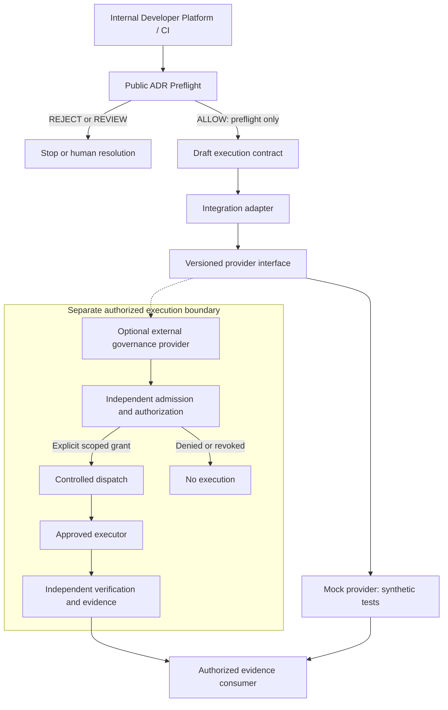
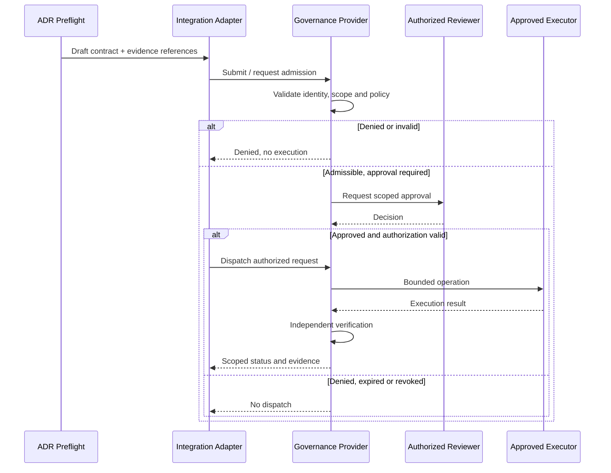

# Experiment 002 — External Execution Governance Provider

**Status:** proposed architecture and interoperability experiment; not implemented. No commercial relationship, product availability, enterprise deployment, or authorization to integrate is implied.

## Objective

Evaluate whether the public ADR Preflight PoC can hand off validated architectural intent to a separately operated, replaceable execution governance provider through versioned, implementation-neutral contracts.

The public project must remain independently useful and runnable. An external provider may be open-source, proprietary, internally developed, or an existing enterprise capability. The Execution Delivery Harness (EDH) is a candidate for a future separately evaluated provider; it is not a required dependency or an endorsed enterprise product.

## Separation of responsibilities

| Component | Responsibility | Boundary |
|---|---|---|
| Public ADR Preflight | Structural and semantic ADR validation, model evaluation, preflight decision and draft contract | No execution permission or provider-specific runtime dependency |
| Shared interface | Versioned request, decision, authorization reference and evidence envelopes | Implementation-neutral; only reviewed public schemas |
| Integration adapter | Translate between approved IDP workflow and provider interface | Organization-specific configuration stays in an authorized environment |
| External governance provider | Admission, authorization, controlled dispatch, revocation and verification | Independently governed; implementation need not be publicly available |
| Enterprise executor | Perform an explicitly authorized operation in an approved environment | Existing organizational execution and identity controls remain authoritative |
| Observer / evidence consumer | Present authorized run status and verification evidence | Read-only, scoped to the consumer's permissions |

## Proposed architecture

All provider and execution components shown are proposed interfaces or target capabilities, not a deployed integration. A successful preflight does not imply permission to execute. The public PoC does not hold production credentials or dispatch actual tasks.

## Candidate deployment models

| Model | Deployment boundary | Considerations |
|---|---|---|
| Self-hosted provider | Operator-controlled infrastructure; reviewed, versioned package | Candidate for an isolated pilot; supports local data handling, but packaging is not a confidentiality guarantee. |
| Managed control plane | Separately operated service with approved enterprise adapters | Requires explicit review of network access, tenancy, data handling, identity, audit and operational obligations. |
| Dedicated isolated instance | Separate approved account or environment | May simplify isolation but adds deployment and support responsibilities. |
| Existing enterprise provider | Reuse current capabilities via an adapter | Prefer reuse where it satisfies the requirements; no new provider is required. |

No model has been selected. Discovery, security review, rights to use the software, licensing, and operational requirements determine the appropriate choice. A container does not prevent inspection or extraction of its contents.

## Proposed interface (not a published API)

The following are conceptual operations, not claims about endpoints that already exist.

| Operation | Intended effect |
|---|---|
| submit_execution_contract | Submit a versioned, immutable draft bound to source and policy evidence. |
| request_admission | Evaluate the request under the provider's independent policy. |
| request_approval | Initiate the appropriate explicit approval process; approval is not inferred from model output. |
| dispatch_authorized_task | Dispatch only after validating an applicable, unexpired, non-revoked authorization. |
| get_run_status | Return scoped status and correlation identifiers. |
| get_verification_evidence | Return authorized, provenance-bound verification evidence. |
| revoke_authorization | Revoke a grant under the provider's policy; distinguish queued from already-running actions. |

Version negotiation, error semantics, actor identity, evidence integrity, idempotency, retry and revocation behavior must be specified before an actual integration. No permission or signing material is embedded in public contracts. Existing contracts may be reused only after compatibility and licensing review.

The sequence describes intended behavior, not an implementation guarantee. In-flight cancellation and irreversible side effects require explicit semantics; revocation cannot undo completed effects.

## Experiment plan

1. Define a minimal public provider contract and a synthetic mock implementation, with no private repository dependencies or external calls in public CI.
2. Add contract tests against the mock, including negative paths. Keep the standalone preflight decision behavior unchanged.
3. Introduce an optional adapter interface that can point to any compatible provider. Use synthetic requests and isolated test identities.
4. Evaluate an independently authorized provider in a separate, approved sandbox only after discovery, technical/security review, and agreement on IP and licensing. Run the same contract suite; record the exact provider/version and known gaps in the authorized environment.
5. Compare evidence handoff and failure behavior. Recommend reuse, adaptation, deferment or no integration. An existing internal provider may be the best choice.

## Acceptance gates

| Test | Required evidence |
|---|---|
| Standalone independence | Public CLI and CI pass with no provider, private dependencies or credentials. |
| Mock interoperability | Versioned envelopes round-trip and correlate draft, admission, status and evidence. |
| Negative admission | Invalid or incomplete contract, unauthorized actor, wrong scope or missing approval never dispatches. |
| Replay / expiry / revocation | Duplicate requests, expired grants and revoked grants are rejected or handled idempotently according to a specified policy. |
| Provider failure | Timeout, malformed response or unavailable provider does not turn preflight ALLOW into runtime permission. |
| Evidence | Verification record is traceable to the authorized request and execution result; missing evidence is explicit. |
| Portability | A compatible independent provider can replace the mock without changing admission policy. |
| Data and IP boundary | No private implementation, credentials, internal data or unpublished configuration in public repository, CI or artifacts. |

Public CI proves contract-harness behavior only. A real provider test requires separately approved access and produces a separately identified evidence report. No claim of a production-ready closed product follows from mock tests.

## Intellectual property and publication boundaries

- The public PoC, its public interfaces, and the separately developed provider remain distinct work products. Do not import private implementation into public code, logs, diagrams or documentation.
- Before any enterprise pilot or employment-related integration, identify pre-existing IP, applicable licenses and third-party dependencies; clarify ownership of integration work and rights to use, modify, distribute and support each component in writing with appropriate parties.
- A proprietary provider is optional. No commercial terms, license grant, access rights, employer approval or ownership allocation is made by this proposal. Obtain appropriate legal and security review before any actual integration or distribution.
- Keep organization-specific adapters, architecture, data, resource inventories and credentials in the approved environment. Publish only reviewed, synthetic and implementation-neutral evidence.

## Relationship to the December research plan

This is an optional follow-on to [Phase 0](Phase-0-Organizational-and-Technical-Discovery.md) and the [mid-December integration test intent](Mid-December-2026-Integration-Test-Intent.md). Initial work may consist entirely of public interface design and mock contract tests. It is not a commitment to integrate a specific provider on December 8–10. Real integration is gated by organizational need, access, reuse analysis and approvals.

**Exit criterion:** demonstrate provider-neutral interoperability using synthetic evidence, preserve independent admission and execution authority boundaries, and identify the conditions required for a future authorized pilot. Neither a particular provider nor a commercial outcome is required.
