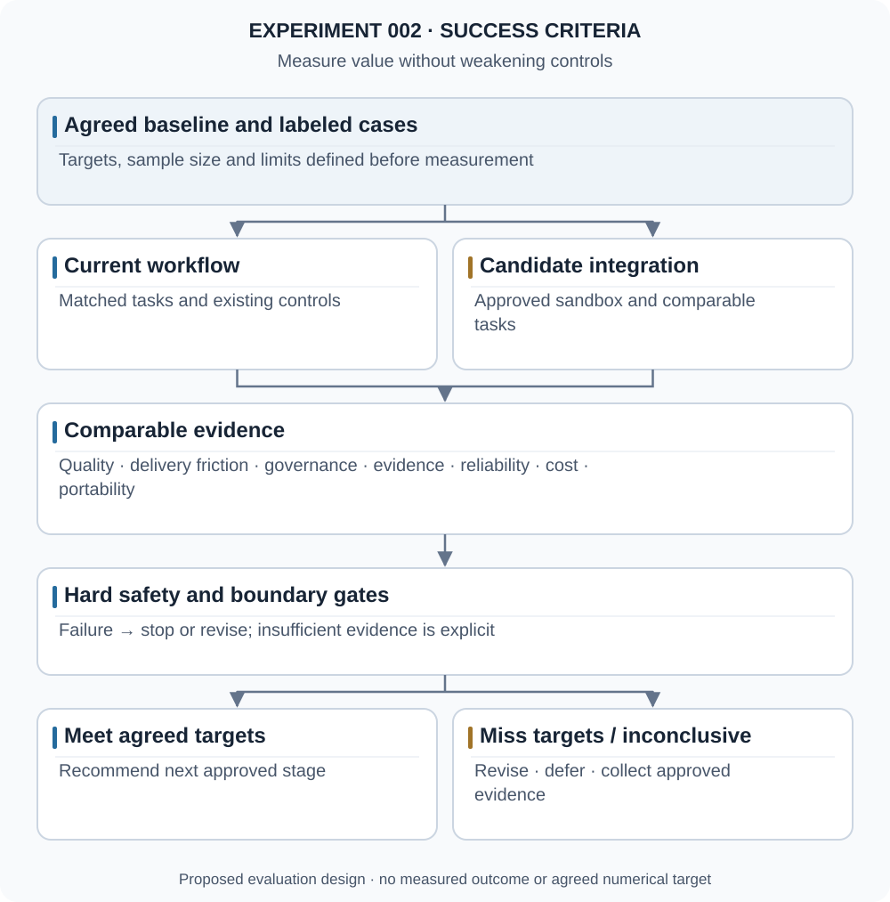
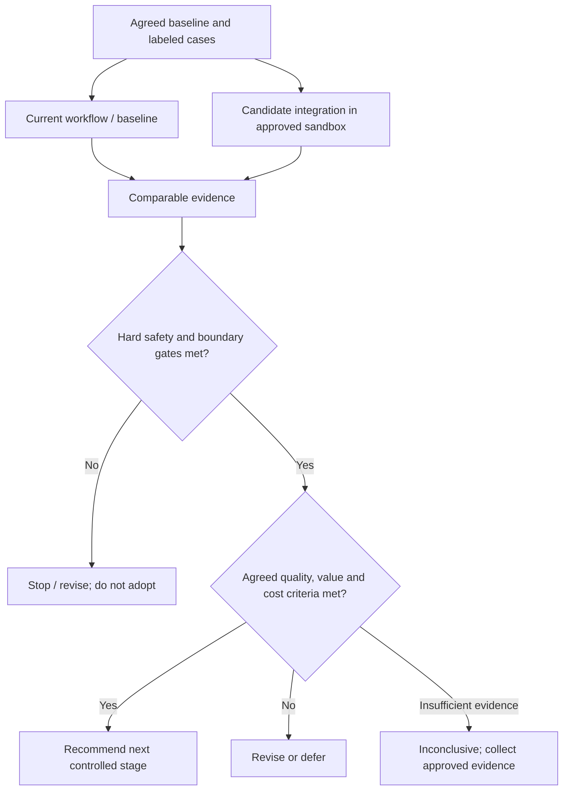

# Experiment 002 — Success Criteria and Evidence Plan

**Status:** proposed evaluation framework. No baseline, targets, measured outcomes or provider acceptance are established. This document is for elaboration, not implementation.

## Evaluation objective

Determine whether a selected integration pattern measurably helps an agreed team objective without weakening architecture admission, execution authorization, data protection or operational reliability. Measure against an existing workflow or agreed independent baseline. A negative or inconclusive result is valid.

## Hypotheses and metrics

| Area | Metric / method | Desired direction; target to agree |
|---|---|---|
| Review quality | TP/FP/FN against labeled issues; exact match, recall, precision and invalid output rate | Fewer missed relevant issues without unacceptable false positives |
| Delivery friction | Paired review lead time, reviewer active minutes, rework rounds on comparable cases | Lower burden without lower quality |
| Governance | Unauthorized dispatch attempts versus observed successful unauthorized dispatches; valid authorized paths | Zero unauthorized dispatches in the defined negative suite; authorized scenarios work |
| Evidence | Complete correlation from draft/source and policy to admission, approval, run and verification | All required evidence fields and references present in defined suite |
| Reliability | Timeouts, malformed responses, duplicate/replay behavior, recovery and missing evidence | Fail closed; predictable bounded retries and documented recovery |
| Efficiency | Per-run latency, token usage, compute consumption and incremental operational cost | Within agreed budget and acceptable trade-off |
| Portability | Standalone regression parity and adapter contract test results | No mandatory private dependency; preserve deterministic policy |
| Adoption / ownership | Integration effort, operational burden, owner feedback and rollback exercise | Sustainable with agreed team capacity |

Numeric performance thresholds, sample size, acceptable regression margins and cost caps are deliberately TBD during elaboration. The zero-unauthorized-dispatch criterion applies to the defined test suite; it is not a proof of absolute security.

## Comparison and measurement design

1. Agree the real objective, metric definitions, baseline and eligible cases before running tests.
2. Start with synthetic fixtures and a hypothetical mock; only later use approved sandbox cases. Separate fixture results, measured live inference and actual provider integration evidence.
3. Compare matched tasks and configurations where feasible; record source/policy versions, model/provider versions, order, resource limits, failures and missing metrics. Do not silently discard failures.
4. Use independent expected outcomes for quality and explicit negative authorization tests. Review evidence with the appropriate owner. Report uncertainty, sample limitations and confounders.
5. Compare value and total cost against existing services and no change. Do not claim superiority from a green CI or a small uncontrolled pilot.

*Visual overview. Proposed evaluation design · no measured outcome or agreed numerical target. The detailed Mermaid diagrams below retain the logical representation.*

## Mandatory gates for a later pilot

| Gate | Expected evidence |
|---|---|
| Preflight independence | Standalone behavior unchanged with provider absent; no model or graph grants runtime authority. |
| Negative authorization | Missing approval, wrong scope, wrong actor, expiry, revocation and replay do not permit unauthorized execution. |
| Failure handling | Provider outage, malformed/truncated output or missing evidence never creates a grant; explicit failure status. |
| Data/IP | Approved data flows and access; no private implementation, tokens or corporate material in public artifacts. |
| Recovery | Disable/rollback path tested in sandbox; residual and irreversible effects documented. |
| Evidence | Reproducible versioned test record and traceable authorized execution evidence where real execution is in scope. |
| Operational readiness | Named owner, approved limits and support path; no production rollout implied. |

These are candidate hard gates for scope agreement; untested gates remain unverified, never automatically passed.

## Proposed evidence package

- Experiment charter and frozen baseline/targets, versioned test matrix and expected labels.
- Sanitized run manifest, per-case outcomes and aggregated comparison with missing-data accounting.
- Decision/routing evidence, invocation counts, timings, token usage when available, authorization and verification references.
- Negative-path, timeout, recovery and rollback results; known gaps and threat-boundary review.
- Cost/effort summary, owner review and explicit proceed/revise/defer/stop recommendation.

Publish only approved synthetic or sanitized evidence. Private organizational details and raw internal logs remain in the authorized environment.

## Decision rules

Hard gate failure → stop or revise. If hard gates pass but agreed value targets are missed → revise/defer. Insufficient data → inconclusive. If gates and agreed targets pass → recommend a separately approved next stage, not automatic production adoption or commercial selection. Current status: **NOT MEASURED / NOT APPROVED FOR IMPLEMENTATION**.

## Related artifacts

- [Elaboration and decision gates](Experiment-002-Elaboration-and-Decision-Gates.md)
- [Team integration options](Experiment-002-Team-Integration-Options.md)
- [Architecture proposal](Experiment-002-External-Execution-Governance-Provider.md)
