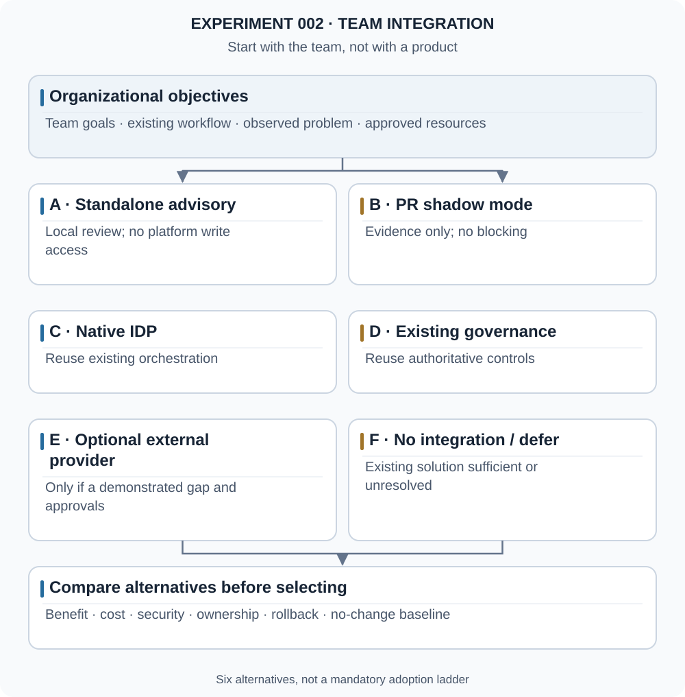
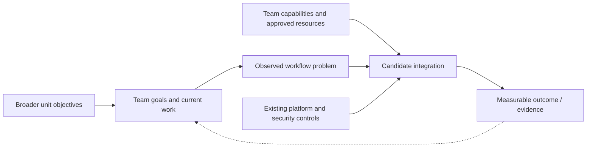
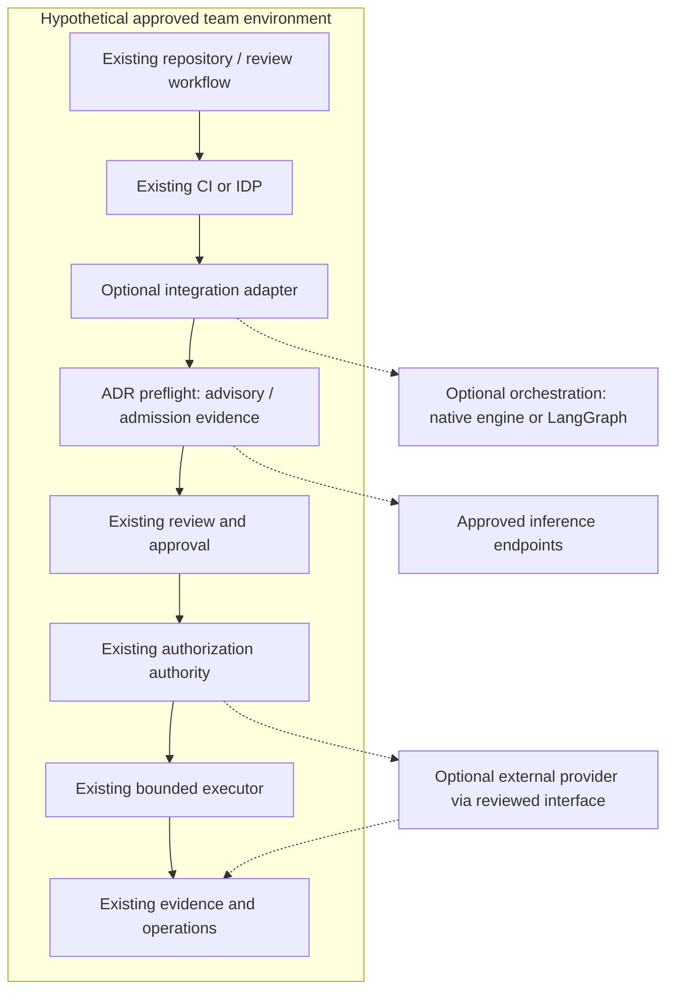

# Experiment 002 — Hypothetical Team Integration Options

**Status:** alternatives for elaboration only. This is not a description of any actual company's architecture or a proposal already accepted by a team.

## Start from the team, not from the product

An integration must fit the team's mandate, capabilities, resources, current backlog and the objectives of the larger engineering or product unit. Use Phase 0 discovery to identify the actual workflow and ownership. Do not introduce a new runtime, model stack or orchestration layer simply because the PoC supports it.

*Visual overview. Six alternatives, not a mandatory adoption ladder. The detailed Mermaid diagrams below retain the logical representation.*

## Integration patterns

| Pattern | Entry point / team context | Benefit hypothesis | Constraints and exit path |
|---|---|---|---|
| A — Standalone advisory | CLI or local review by an engineer; no platform write access | Find structural/semantic issues before implementation | Synthetic inputs first, no runtime permission; remove tool with no pipeline impact. |
| B — PR advisory / shadow mode | Existing source control and CI; findings/evidence only | Earlier review and measure noise without blocking delivery | Trusted policy revision, no credentials in public PR; disable advisory job. |
| C — Native IDP workflow | Existing approved workflow engine or API | Reduce handoff friction and reuse platform identity, state and telemetry | Reuse internal orchestration if sufficient; LangGraph is an option, not mandatory. Revert adapter/routing. |
| D — Existing execution governance | Existing authorization/execution provider via narrow interface | Preserve organizational controls while improving traceability | Map semantics, identity, authorization and verification; no bypass. Remove optional adapter. |
| E — Optional separately operated provider | Approved sandbox, unmet governance need and independent review | Evaluate a replaceable external runtime, potentially EDH | Separate IP/licensing, security and operations review; no private source in public project. Disable adapter and revoke pilot grants. |
| F — No integration / defer | No agreed problem, existing capability sufficient or unavailable approvals | Avoid unnecessary cost and risk | Document rationale and revisit only with new evidence. |

Patterns may be incremental, but are not a mandatory adoption ladder. Compare each with the current workflow and no-change alternative. Never introduce an enforcement gate or external provider solely on the basis of a synthetic demo.

## Candidate integration boundary

Dashed connections are alternatives, not implemented components or required data flows. The organization's authorized execution boundary remains authoritative. No private documents or credentials flow into public CI. No public endpoint, personal workstation or external telemetry service is required.

## Deployment choices to compare during elaboration

- Reuse a native internal capability where sufficient.
- Self-host a reviewed, versioned external component inside an approved boundary, if licensing and distribution permit it. An OCI image is not a secrecy guarantee.
- Consider a dedicated isolated instance or managed control plane only if data residency, egress, identity, audit, tenancy, operational support and procurement are approved.
- Keep the public PoC and independently developed EDH implementation separate. No particular private provider is chosen here.

## Discovery-to-option mapping template

Complete in an authorized internal location, not in public Wiki:

| Field | Status in this public template |
|---|---|
| Team / broader unit objective and problem owner | Unknown |
| Existing workflow and measurable baseline | Unknown |
| Team capabilities and reusable services | Unknown |
| Available, approved resources and constraints | Unknown |
| Candidate pattern and alternatives | Not selected |
| Integration interface, ownership and rollback | Not agreed |
| Data/identity/IP review | Not performed |
| Success criteria and decision authority | Not agreed |

## Proposed participation model

Staff/senior IC and architect review boundaries and reuse; team lead and group lead validate priority, capacity and expected outcomes; platform/inference/security owners validate interfaces and permitted environment; appropriate legal/IP stakeholders review any external product arrangement. Actual roles and decision rights are to be confirmed. Do not collect confidential details outside approved channels.

## Related artifacts

- [Elaboration and decision gates](Experiment-002-Elaboration-and-Decision-Gates.md)
- [Success criteria and evidence](Experiment-002-Success-Criteria-and-Evidence.md)
- [Architecture proposal](Experiment-002-External-Execution-Governance-Provider.md)
