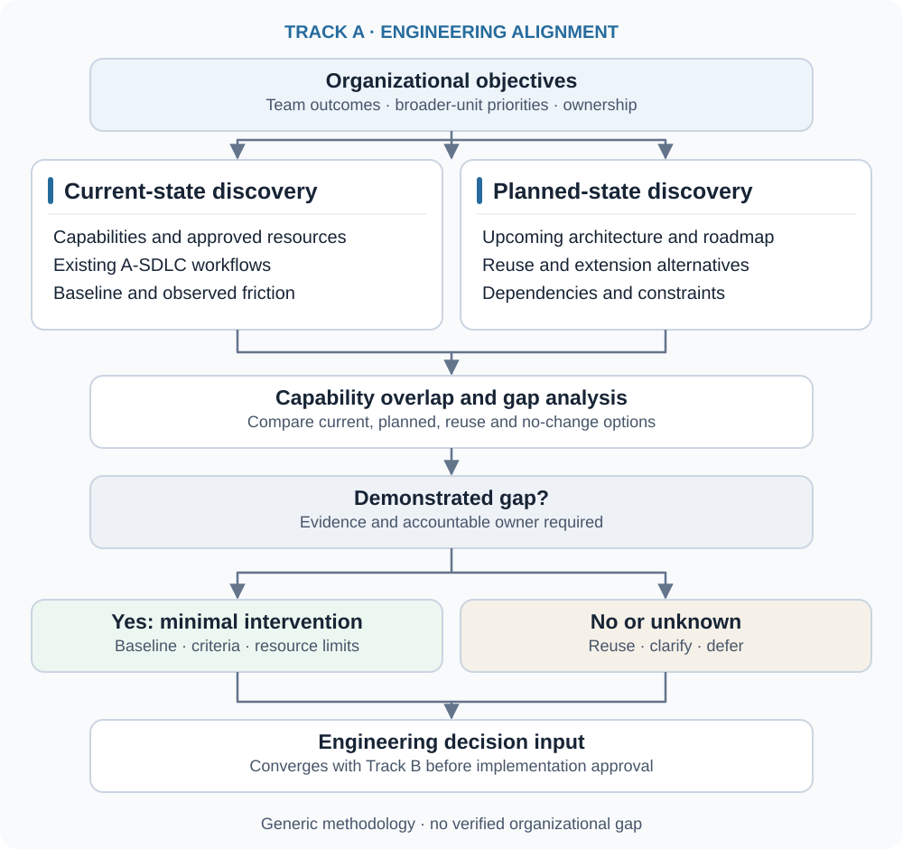
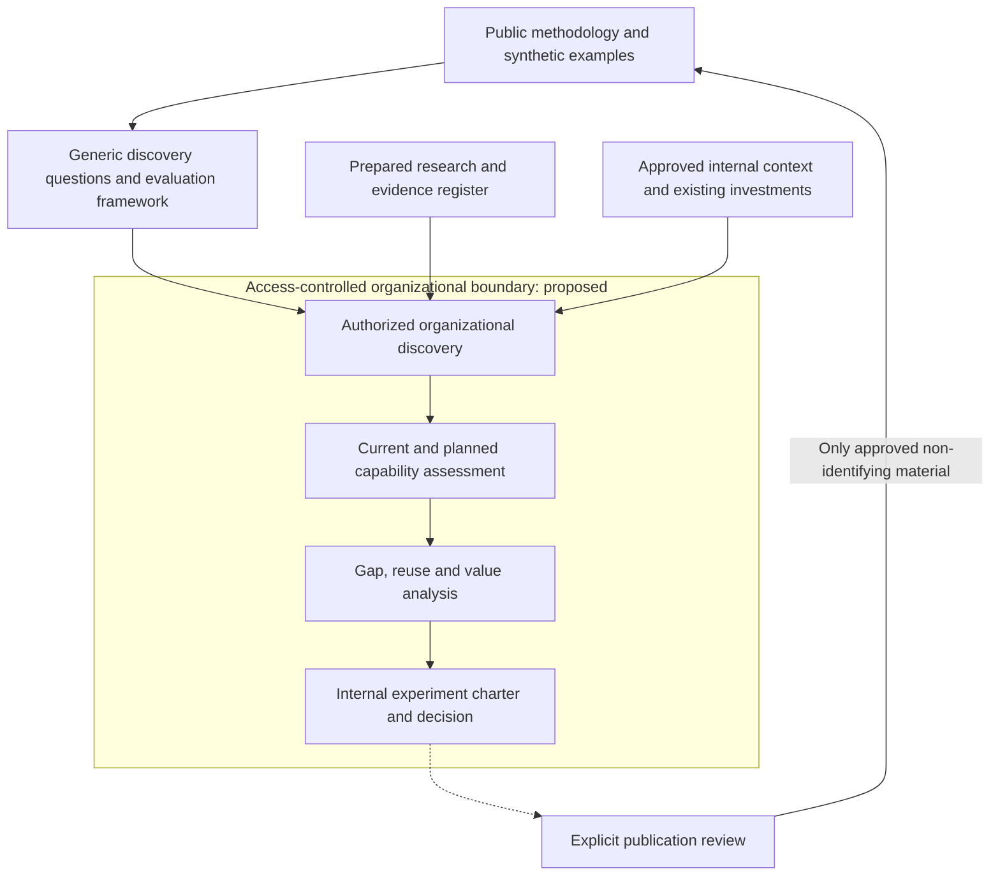
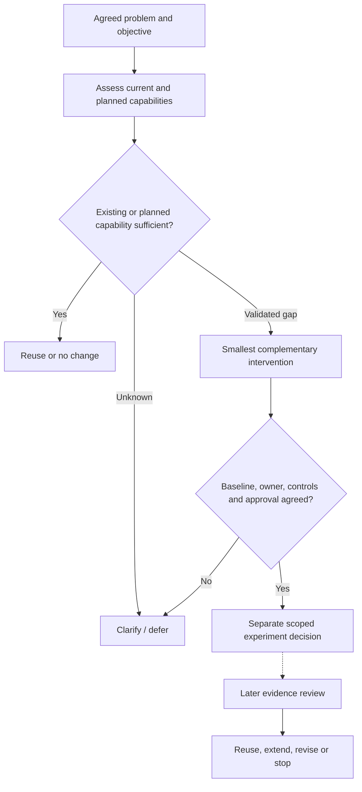

# Experiment 003 — A-SDLC Organizational Alignment

**Status:** ELABORATION / DISCOVERY REQUIRED. Documentation only; no implementation, organizational access, deployment or adoption is authorized.

## Track A — Engineering Alignment

This is the engineering workstream of the [Integrated Engineering and Knowledge Governance Framework](Experiment-003-Integrated-Engineering-and-Knowledge-Governance.md). The complementary [Knowledge & IP Governance workstream](Experiment-003-Demonstration-and-Disclosure-Boundaries.md) establishes the permitted information and technology boundaries. Both contribute to the combined readiness decision.

*Figure 1. Engineering workstream overview; detailed Mermaid diagrams follow.*

## Purpose

A-SDLC (Agentic Software Development Lifecycle) extends software delivery practices with agent-assisted reasoning, planning, implementation, validation and operational feedback. The purpose of this experiment is to identify a measurable, complementary contribution to an existing organization's A-SDLC, rather than to reproduce its current or emerging capabilities.

Public research can help prepare discovery. It cannot establish the current internal architecture, the actual team's priorities, the capabilities available to that team or its future roadmap. Those questions require appropriate organizational context and authorized discussion.

## Publication and knowledge boundaries

This public artifact describes the investigation method, generic decision criteria and proposed evaluation design. It intentionally excludes organization-specific evidence and findings, the identity of any prospective integration organization, source links that identify it, internal architecture, product/roadmap mapping, competitive analysis, interview notes and recommendations derived from a specific organizational context.

Publicly available facts are not made confidential by this policy. However, the curated evidence set, its selection, relationships, interpretation and organization-specific engineering implications may represent substantial prior research and accumulated know-how. Existing organizational investments in architecture, engineering workflows, evaluation and operations also deserve protection. A public prototype does not require publishing either body of knowledge.

The organization-specific working context should be maintained separately in an approved access-controlled environment. It may combine authorized existing organizational knowledge with independently prepared research where the applicable rights, security requirements and approval permit. Its contents must not be exported to public repositories, Wiki, public CI artifacts, external inference or telemetry services without explicit authorization. No actual organizational workspace, access, ownership allocation or permission to transfer material is assumed.

The diagram is a proposed information-handling model, not an existing corporate data flow. Transfer into the organizational boundary is conditional on appropriate authorization and rights.

## Demonstration and disclosure policy

See [Demonstration and Disclosure Boundaries](Experiment-003-Demonstration-and-Disclosure-Boundaries.md) for the public / restricted (potential NDA-only) / internal information model, staged demonstration plan and theoretical confidentiality position. An NDA is not assumed to exist; restricted disclosure and internal transfer require separate explicit authorization and applicable rights.

## Research hypotheses

| ID | Hypothesis to evaluate privately |
|---|---|
| H1 | A candidate capability addresses an agreed engineering problem and contributes to a team or broader-unit objective. |
| H2 | Existing and planned organizational capabilities can be reused wherever sufficient; a new component is justified only by a demonstrated gap. |
| H3 | An intervention improves measurable engineering effectiveness without increasing unacceptable review, integration or operational burden. |
| H4 | An intervention preserves authoritative security, human accountability, admission and execution boundaries. |
| H5 | Traceable evidence and observability can be improved using approved existing reporting and telemetry infrastructure rather than duplicating it. |

No hypothesis is established by this publication.

## Discovery and reuse-first framework

The following dimensions are generic questions, not a description of any company's systems or deficiencies.

| Dimension | Questions to resolve with appropriate owners |
|---|---|
| Organizational objectives | What outcomes matter to the team and the broader unit? Which current and upcoming workstreams drive them? |
| A-SDLC coverage | Which lifecycle stages are already assisted, automated or governed? Where are evidenced friction and gaps? |
| Architectural intent | How are requirements, design decisions, policy, acceptance criteria and change evidence represented and linked? |
| Platform and agents | Which approved workflows, orchestration, model interfaces, evaluation services and integration points should be reused? |
| Control | Which authorities own identity, approval, policy, execution, revocation and verification? |
| Reporting and observability | Which metrics, audit records and traces already exist? Can they be correlated across lifecycle stages? |
| Resources and ownership | What capabilities, capacity, permissions, environments, support and operational constraints apply? |
| Evolution | Which approved near-term changes make a proposed capability redundant or change its required interface? |

Capture answers and supporting evidence only in the approved working context. Confirm source date, scope, confidence and decision owner. Separate observed use, intended direction and unresolved hypotheses; absence of evidence is not a verified gap.

## Evaluation dimensions

| Dimension | Candidate measurements | Guardrail |
|---|---|---|
| Effectiveness | Matched review lead time, active engineering time, rework, issue recall and precision | Include false positives, failures and downstream outcomes. |
| Control | Negative-path outcomes, approval coverage, scope enforcement, replay and recovery | Existing authority remains authoritative; no unauthorized dispatch in the defined suite. |
| Accountability and reporting | Completeness of links between source, decision, approval, execution and verification; report effort | Evidence integrity and approved data handling, not log volume. |
| Observability | Stage-level trace coverage, diagnostic time, error attribution, latency distributions | Reuse approved telemetry, retention and redaction; account for overhead. |
| Efficiency | Compute/token cost per accepted task or correct finding, integration and maintenance effort | Compare equivalent workloads and no-change alternative. |
| Reliability and adoption | Valid completion, failure recovery, operational ownership and user burden | Scope and rollback agreed; no forced adoption. |

Baselines, quantitative targets, sample sizes, regression tolerances and cost limits are deliberately undefined until elaboration. These are evaluation candidates, not measured outcomes.

## Internal evidence package — outline only

A future authorized workspace may contain a dated evidence register with provenance, a current/planned capability map, a reuse and overlap assessment, unresolved questions with owners, agreed baseline and metric definitions, a security/IP review, and a scoped decision record. Do not populate these organization-specific artifacts in this public repository.

Use an appropriate approval and access model for internally shared material. Do not assume that preparing a public proposal grants permission to access, transfer, license or reuse any private implementation or organizational information.

## December planning intent

| Date | Candidate elaboration activity |
|---|---|
| 8 December 2026 | Review generic A-SDLC discovery framework; establish questions, boundaries and missing context. |
| 9 December 2026 | If authorized, review current and anticipated capabilities, reuse options and measurable gaps within the approved environment. |
| 10 December 2026 | Draft a scoped internal experiment charter or document reuse/defer/no change. |
| Mid-December | Review readiness and decide whether to authorize a separate implementation plan. |

These dates are planning targets, not confirmed meetings or commitments. If authorized organizational context is unavailable, the work remains generic elaboration.

## Definition of ready

- [ ] Agreed problem, owner and organizational outcome.
- [ ] Current and anticipated capabilities assessed through authorized evidence.
- [ ] Reuse, extension and no-change options considered; any gap supported by evidence.
- [ ] Baseline, evaluation criteria, permitted scope, controls, resources and evidence handling agreed.
- [ ] IP, data handling and security reviewed where applicable.
- [ ] Explicit implementation decision documented.

**Current status: discovery required; no verified organizational gap; no implementation authorization.** Public methodology is not a publication of the underlying organization-specific research. No application code, API schema, CI change or external provider integration is part of this increment.

## Living research portfolio

The [A-SDLC Research Portfolio](A-SDLC-Research-Portfolio.md) maintains independent candidate research directions, evolving value assessments, priorities, ownership and review decisions. It is a supporting organizational register, not a set of approved experiments or an implementation commitment. Engineering alignment informs its relevance, reuse and value assessment.

## Related public methodology

- [Phase 0 — Organizational and Technical Discovery](Phase-0-Organizational-and-Technical-Discovery.md)
- [Experiment 002 — Elaboration and Decision Gates](Experiment-002-Elaboration-and-Decision-Gates.md)
- [Experiment 002 — Success Criteria and Evidence Plan](Experiment-002-Success-Criteria-and-Evidence.md)
- [Mid-December integration intent](Mid-December-2026-Integration-Test-Intent.md)
