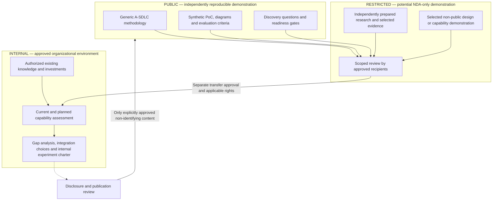
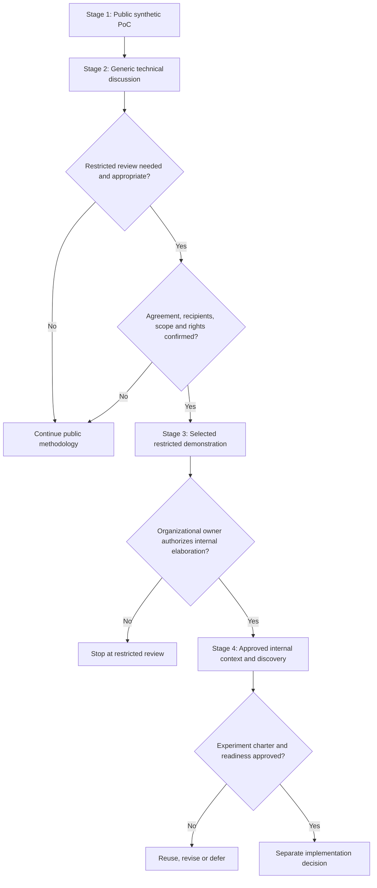

# Experiment 003 — Demonstration and Disclosure Boundaries

**Status:** proposed information-handling and demonstration policy for elaboration. Not a signed NDA, legal opinion, license, corporate policy, or approval to disclose. No prospective organization is identified.

## Intent

Demonstrate engineering competence and research methodology publicly while protecting the accumulated knowledge, investments, intellectual property and organization-specific conclusions of all parties. Public availability of individual source facts does not require publication of a curated evidence collection or its derived engineering analysis. This proposal governs our own disclosure choices; it does not assert that public facts become trade secrets.

## Three information zones

This is a conceptual boundary, not a deployed information system. Restricted material is not automatically internal material. Internal material must not be transferred to a restricted external audience simply because an NDA exists. Each boundary crossing requires separate review.

## Demonstration content matrix

| Artifact / component | Public | Restricted demonstration (NDA-only candidate) | Internal organizational context |
|---|---|---|---|
| Generic A-SDLC discovery methodology and diagrams | Yes | Yes | Reusable |
| Synthetic PoC, public contracts and tests | Yes, reviewed synthetic material | Yes | Reusable subject to applicable policy |
| Generic success criteria and evaluation framework | Yes | Yes | Refined to agreed baseline and goals |
| Identity of prospective organization / participants | No | Only if independently authorized | Need-to-know |
| Curated organization-specific public-source evidence and derived analysis | No | Selected independent research, subject to review | Approved transfer only |
| Existing internal capabilities, investments, roadmap and priorities | No | No by default; requires separate owner authorization | Need-to-know, approved environment |
| Capability overlap, gaps, reuse and integration recommendations | Generic method only | Independent hypotheses only, explicitly approved | Contextualized findings |
| Private provider architecture / capability demonstration | Public abstraction only | Selected black-box demonstration if authorized | Separately approved evaluation; no assumed source access |
| Private provider implementation, source or distribution artifacts | No | Not included by default | Separate IP, license, distribution and security agreement |
| Real internal metrics, reports, traces, logs and datasets | No | No by default | Approved evidence handling and access controls |
| Credentials, signing keys, privileged tokens | Never | Never | Approved secret management; never demonstration material |

"Yes" refers to the intended publication boundary, not an unrestricted right to disclose third-party material. Rights, provenance, classification and approval must be checked for every artifact.

## Proposed staged demonstration

Stage 1 demonstrates standalone behavior using synthetic examples. Stage 2 explains hypotheses and evaluation method without revealing company-specific findings. Stage 3, if appropriate, may present selected independently held research or a private black-box capability in a controlled session. Stage 4 contextualizes research with authorized internal knowledge; actual corporate assessment remains inside the approved boundary. None of these stages is a commitment to disclose source code, transfer IP, supply a product or start implementation.

## Theoretical NDA-only position

The default public offer is a generic, independently reproducible demonstration. A deeper demonstration of independently held non-public research or technology may be considered only under an appropriate written confidentiality agreement, subject to the disclosing party's rights and approval. Where both parties may disclose protected material, a mutual NDA is a possible starting point for discussion, not a required or agreed legal form.

Before any restricted session, the parties would need to agree:

- Purpose and scope of the evaluation, authorized recipients and need-to-know access.
- Which materials may be shown, shared, retained, copied, recorded or redistributed, and how they are classified.
- Appropriate secure channels, storage, access controls, retention/return/deletion arrangements and incident handling.
- Treatment of pre-existing IP, third-party material, and independently developed research; no implied license, assignment or grant of implementation rights.
- Applicable confidentiality exceptions, duration and other legal terms, reviewed by appropriate authorized parties and qualified counsel.

An NDA alone does not authorize corporate system access, data export, model ingestion, external processing, repository access, software distribution, source disclosure, production execution or use of a private product. Separate approvals and agreements may be needed. Do not request or accept restricted company information in an interview setting without authorization. No NDA is assumed to exist and no legal terms are offered for acceptance here.

## Readiness and publication checklist

- [ ] The artifact owner, provenance and applicable rights are identified.
- [ ] Information classification, audience, purpose and permissible disclosure are confirmed.
- [ ] For restricted material, an appropriate executed agreement and explicit disclosure authorization are in place.
- [ ] For internal context, the organization's approved environment, access and evidence handling are agreed.
- [ ] Public outputs are reviewed for identifying details, derived confidential findings, private implementation and sensitive metadata.
- [ ] A separate elaboration/implementation decision is recorded if further work is justified.

**Current status:** public methodology only; no restricted disclosure or internal transfer is authorized by this page. No company-specific evidence, private implementation, actual NDA or organizational agreement is published. Public artifacts remain synthetic or generic; internal findings remain internal.

## Related public methodology

- [Experiment 003 — A-SDLC Organizational Alignment](Experiment-003-A-SDLC-Organizational-Alignment.md)
- [Phase 0 — Organizational and Technical Discovery](Phase-0-Organizational-and-Technical-Discovery.md)
- [Experiment 002 — External Execution Governance Provider](Experiment-002-External-Execution-Governance-Provider.md)
