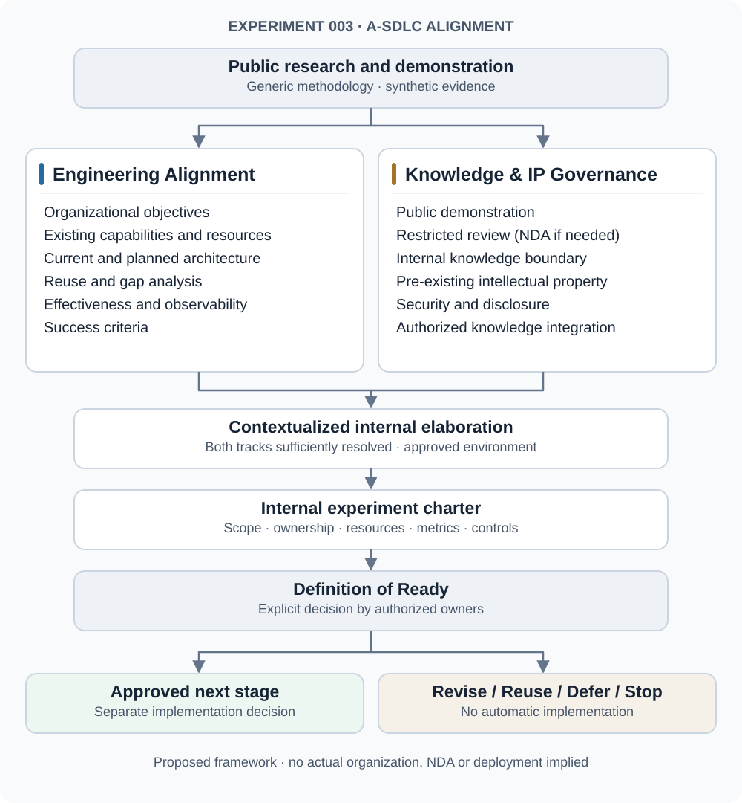
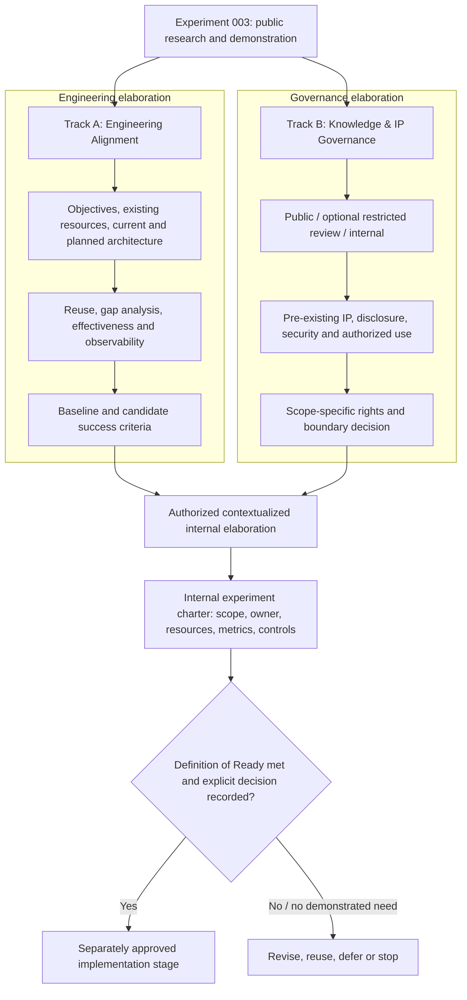

# Experiment 003 — Integrated Engineering and Knowledge Governance Framework

**Status:** ELABORATION / DISCOVERY REQUIRED. This is an independent, public planning framework, not an implemented corporate architecture, agreement or authorization. No prospective organization is identified.

## Executive overview

Experiment 003 has two complementary workstreams. **Engineering Alignment** determines what, why and how to integrate, with reuse of existing and planned capabilities as the default. **Knowledge & IP Governance** determines what may be shown, transferred and used, by whom and within which approved boundary. Both must be resolved to the extent required by the proposed scope before an implementation decision.

> Technology selection must follow organizational discovery, while knowledge disclosure must follow explicit authorization. Both are prerequisites for implementation readiness.

*Figure 1. Proposed integrated framework. The static diagram is a reading aid; the Mermaid source below is the versioned logical representation.*

The tracks may progress independently, but are not independent authorizations. A technical fit does not grant disclosure rights. An executed NDA does not establish a technical need, access rights, a product license or permission to implement. A restricted demonstration is optional and is not required when all needed inputs are already authorized or public.

## Track navigation

| Workstream | Question | Public artifact | Expected decision input |
|---|---|---|---|
| A — Engineering Alignment | What problem merits a contribution, and what should be reused? | [A-SDLC Organizational Alignment](Experiment-003-A-SDLC-Organizational-Alignment.md) | Evidence-backed problem, current/planned capability assessment, smallest complementary change, baseline and success criteria |
| B — Knowledge & IP Governance | What information and technology may be disclosed, used or transferred? | [Demonstration and Disclosure Boundaries](Experiment-003-Demonstration-and-Disclosure-Boundaries.md) | Approved audience, scope, rights, data/security boundaries and permitted evidence |

## Convergence and accountability

| Stage | Engineering input | Governance input | Outcome |
|---|---|---|---|
| Public demonstration | Generic architecture and synthetic results | Reviewed, non-identifying material | Technical discussion; no organizational conclusions |
| Discovery | Objectives, owners, current/planned capabilities and alternatives | Appropriate access, disclosure and data handling | Authorized problem and constraint assessment |
| Internal elaboration (if authorized) | Baseline, proposed intervention and evaluation design | Scope, IP, security, evidence and operational review | Internal experiment charter |
| Readiness decision | Demonstrated need, owner, resources, test/rollback plan | Explicit approval and applicable rights | Proceed, reuse, revise, defer or stop |

Actual organization-specific evidence, curated sources, findings and recommendations stay in an approved access-controlled context. This public page does not identify that context or assert it exists.

## Stakeholder perspectives

| Perspective | Contribution to elaboration |
|---|---|
| Staff Engineer / senior IC | System boundaries, current capabilities, reuse, cross-team dependencies and technical evidence |
| Team Lead | Team mandate, backlog, capacity, operational ownership and delivery cost |
| Group Lead | Broader objectives, strategic alignment and protection of existing investments |
| Architect | Alternatives, standards, trust boundaries, interface compatibility and control |
| Security / legal / IP owners, as applicable | Permitted disclosure, data handling, rights, risk and approval requirements |

These are illustrative responsibilities, not assigned roles or actual decision rights.

## Combined Definition of Ready

- [ ] A meaningful organizational objective and evidence-backed problem are agreed.
- [ ] Current and planned capabilities, reuse and no-change options have been assessed.
- [ ] The minimal proposed change, baseline, metrics, constraints and rollback/disable path are agreed.
- [ ] Applicable rights, disclosure boundaries, approved data handling and security controls are established.
- [ ] Accountable owners, resources, permitted scope and evaluation evidence are agreed.
- [ ] The decision authority explicitly approves a separately scoped implementation or records reuse/revise/defer/stop.

Current state: **ELABORATION ONLY; no verified organizational gap; no implementation authorization.** No new application code, API schemas or workflow changes follow from this document.

## Related public methodology

- [Phase 0 — Organizational and Technical Discovery](Phase-0-Organizational-and-Technical-Discovery.md)
- [Experiment 002 — Elaboration and Decision Gates](Experiment-002-Elaboration-and-Decision-Gates.md)
- [Mid-December integration intent](Mid-December-2026-Integration-Test-Intent.md)
