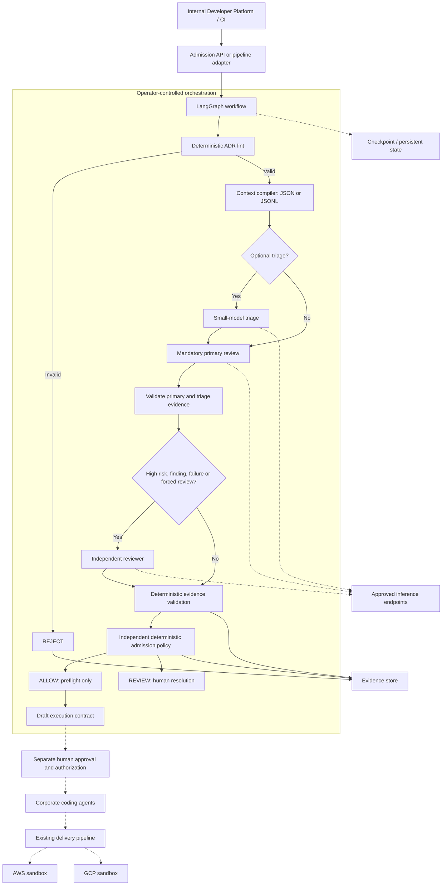
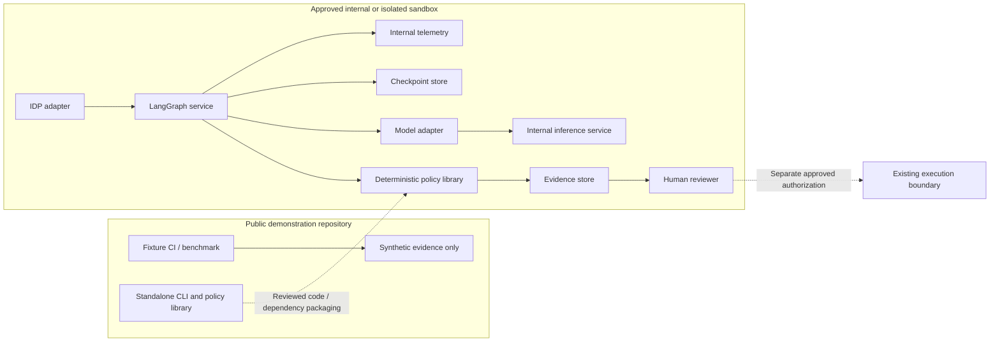
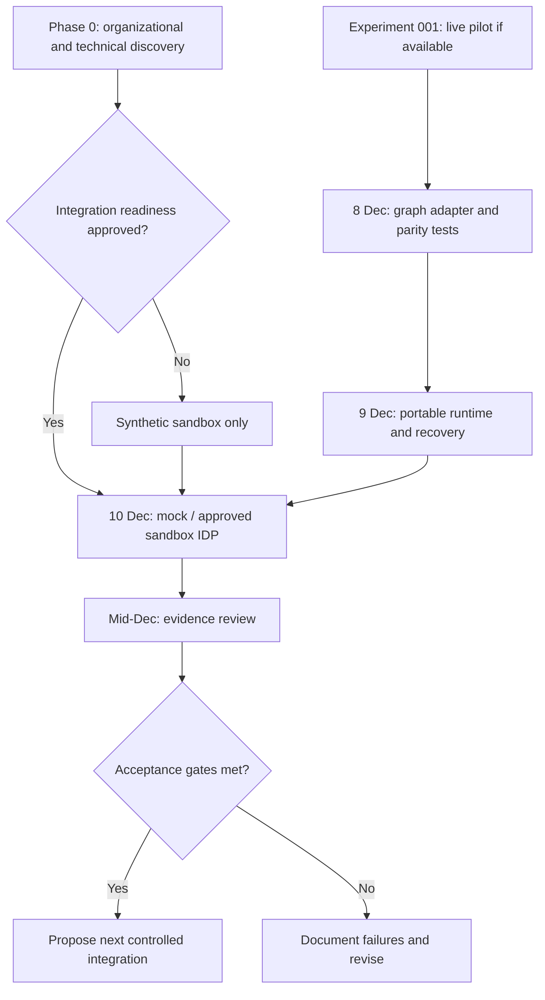

# Mid-December 2026 — Integration Test Intent

**Target window:** 8–10 December 2026 for initial prototyping; mid-December for integration testing and evidence review.

**Status:** proposed research and engineering plan. No corporate environment access, deployment, adoption, or agreement is implied. Dates are planning targets, not commitments to a third party.

## Objective

Evaluate whether the standalone EDH ADR Preflight PoC can be moved into a team's own internal developer platform (IDP) as a portable, governed architecture-to-execution component. The goal is to exercise the complete validation cycle within an operator-controlled trust boundary, using LangGraph for explicit workflow orchestration and LangChain-compatible model adapters where useful, while retaining the deterministic admission engine as an independent library.

The PoC must remain runnable without LangChain, a personal workstation, a particular model vendor, or a mandatory external tracing service. Integration with any actual enterprise environment is subject to its owners' approval, security requirements, and available interfaces. The first target is an isolated mock or approved sandbox, not production.

## Phase 0 — Organizational and Technical Discovery

Before any organization-specific integration, establish team capabilities, approved resources, current architecture, delivery goals and the objectives of the broader organizational unit. Identify a measurable problem and evaluate existing internal alternatives before selecting a PoC integration.

See [Phase 0 — Organizational and Technical Discovery](Phase-0-Organizational-and-Technical-Discovery.md) for stakeholder questions, deliverables, evidence boundaries and readiness gates. Independent sandbox research may proceed in parallel; organization-specific integration is conditional on readiness and approval.

## Starting point — verified as of 25 November 2026

| Capability | Current evidence / limitation |
|---|---|
| Deterministic ADR structural validation | [PR #1 rejection run](https://github.com/edh-project/edh-adr-preflight/actions/runs/45569140916) completed with expected exit 3 and evidence artifact. |
| Bring Your Own Inference (BYOI) | [Regression CI](https://github.com/edh-project/edh-adr-preflight/actions/runs/45570202159) passed; configurable endpoint URLs, ports, model IDs and routing. Live model performance is unverified. |
| JSON vs JSONL small-model pilot | [Experiment 001 / PR #2](https://github.com/edh-project/edh-adr-preflight/pull/2); [benchmark CI](https://github.com/edh-project/edh-adr-preflight/actions/runs/45571575915) passed 24 unit tests and 36 oracle-stub trials. No measured inference advantage yet. |
| Execution contract | Human-authored draft example only; no general contract compiler or runtime authorization. |
| LangChain / LangGraph, internal API, persistence, deployment and corporate IDP | Proposed; not implemented or validated by the existing PoC. |

## Proposed target architecture

All orchestration, API, persistence and integration components shown above are target design. Dashed paths to agents and cloud delivery represent future integration boundaries, not implemented execution. Existing admission semantics remain: invalid structure is REJECT; findings, model failure or high risk are REVIEW; low-risk validated no-finding results may ALLOW preflight only. Neither a model nor a graph grants execution authority.

## Runtime portability and trust boundaries

No personal runner is attached to the public repository. No internal ADRs, credentials, logs, endpoints, or proprietary configurations are copied into public CI or artifacts. Use dedicated identities, least privilege, approved endpoint configuration, bounded input/output and redacted internal telemetry. The proposed graph is not a policy enforcement boundary by itself.

## Test workstreams and intended schedule

| Date | Workstream | Intended deliverable |
|---|---|---|
| Before organization-specific integration; parallel with independent research | Phase 0 discovery | Objective hierarchy, team capabilities, approved resources, current-state architecture, opportunity map and readiness decision. |
| 8 December (Tue) | Orchestration | Typed graph state; deterministic lint, context preparation, optional triage, primary/independent review, evidence validation and policy nodes; fixture/live adapter interfaces; parity with standalone CLI. |
| 9 December (Wed) | Runtime portability | Containerized service or CLI; versioned request/response contract; checkpoint/recovery prototype; configurable endpoints and timeouts; bounded retries; telemetry and evidence storage abstraction. |
| 10 December (Thu) | IDP integration | Mock or explicitly approved sandbox pipeline adapter; evidence handoff; human review interruption/resume; draft contract example; failure-path integration tests. |
| Mid-December review | Evidence and decision | Reproduce fixture and live runs, review model/format results and orchestration parity, document limitations and decide what to carry forward. |

Experiment 001 is a dependency for deciding whether to prefer JSONL, not a requirement that JSONL wins. If live data is unavailable, graph development can proceed with fixture evidence and the existing JSON baseline; format selection remains open.

## Test matrix and acceptance gates

| ID | Test | Expected evidence / gate |
|---|---|---|
| T01 | Invalid ADR | REJECT before inference; zero model calls. |
| T02 | Compatible low-risk ADR | Fixture decision matches CLI; live decision based on validated evidence, not hard-coded expectation. |
| T03 | Conflict / high-risk ADR | Independent review invoked; REVIEW with evidence or explicit reviewer error. |
| T04 | Provider outage, timeout, malformed or truncated output | REVIEW, bounded retries, no ALLOW on failure. |
| T05 | JSON vs JSONL | Paired experiment on the same model and labeled cases; report accuracy, format validity, tokens and latency; no unsupported efficiency claim. |
| T06 | Orchestration parity | Graph and standalone engine agree for fixed inputs and reviewer responses; hashes and decision codes preserved. |
| T07 | Checkpoint and resume | Resume interrupted workflow without changing decision inputs or duplicating committed evidence; replay/duplicate behavior documented. |
| T08 | Human review | Pause/resume with an explicit reviewer decision; no model-generated runtime authorization; draft contract remains non-executable. |
| T09 | Portability | Reproduce on a separate trusted host/container with operator-configured endpoints and no personal infrastructure dependency. |
| T10 | IDP boundary | Mock/approved sandbox request and evidence round trip, including invalid input and failure paths; no cloud changes or credentials issued. |
| T11 | Data boundary | No private source data or secrets in public artifacts; tracing/export destinations configured by operator; reject unauthorized requests in sandbox adapter. |

## Proposed implementation choices (to validate)

| Concern | Candidate |
|---|---|
| Orchestration | LangGraph OSS, typed state and explicit conditional edges |
| Model access | LangChain-compatible adapters or the existing BYOI transport |
| Admission | Existing independent deterministic Python library |
| API | Versioned internal request/response interface; minimal HTTP or CLI adapter |
| Persistence | Local test checkpoint store first; PostgreSQL as enterprise candidate |
| Packaging | Container image; Helm/Kubernetes integration only if required |
| Evidence | Local filesystem for fixtures; S3/GCS or approved internal object storage adapter |
| Observability | OpenTelemetry-compatible internal telemetry, redacted by default |
| Identity and secrets | Approved workload identity and secret manager; no embedded credentials |

These are candidate technologies, not claims about a specific company's stack. LangSmith or other external telemetry is not a mandatory dependency. Exact versions, licensing, provider compatibility, persistence and security policies must be verified during implementation.

## Expected evidence bundle

- Versioned source, dependency lock and reproducible run configuration (no credentials).
- Fixture regression and graph/CLI parity reports.
- Experiment 001 live comparison artifacts when available, clearly separated from fixture results.
- Traceable state transitions, routing reasons, evidence hashes, model invocation counts, timings and error outcomes.
- Checkpoint/recovery and human-review test evidence.
- Mock or authorized sandbox IDP request/response and deployment instructions.
- Explicit gap list, threat-boundary notes, and a go/no-go recommendation.

## Exit criteria and non-goals

The mid-December milestone is successful if a reviewed prototype can be reproduced in an isolated environment, preserves deterministic admission behavior, demonstrates bounded model orchestration and evidence handoff, and clearly reports remaining failures and unknowns. Real enterprise deployment is not required for this milestone. Production readiness, automatic agent dispatch, signed runtime grants, production AWS/GCP changes, and demonstrated universal JSONL superiority are explicitly out of scope.

## Elaboration gate before new implementation

The December dates remain an intent, not an implementation commitment. For Experiment 002 the 8–10 December window is reserved for discovery, architecture/option review and agreement on success criteria; no provider code or integration begins until an explicit readiness decision. See [Elaboration and Decision Gates](Experiment-002-Elaboration-and-Decision-Gates.md), [Team Integration Options](Experiment-002-Team-Integration-Options.md) and [Success Criteria and Evidence Plan](Experiment-002-Success-Criteria-and-Evidence.md). The existing LangGraph/IDP prototype schedule above is conditional on the relevant discovery and readiness decisions.

## Optional follow-on: external execution governance provider

[Experiment 002 — External Execution Governance Provider](Experiment-002-External-Execution-Governance-Provider.md) explores a replaceable provider interface and synthetic contract tests. This is not a prerequisite for December prototyping and does not imply approval to use a particular provider. Any actual provider integration requires separate authorization, licensing and security review.

## Related research

- [Current architectural design](https://github.com/edh-project/edh-adr-preflight/blob/main/docs/architecture.md)
- [Experiment 001: JSON vs JSONL — protocol and checkpoint](https://github.com/edh-project/edh-adr-preflight/blob/experiment/json-vs-jsonl-small-models/docs/wiki/Experiment-001-JSON-vs-JSONL.md)
- [LangGraph documentation](https://docs.langchain.com/oss/python/langgraph/overview) — implementation reference to verify during prototyping.
