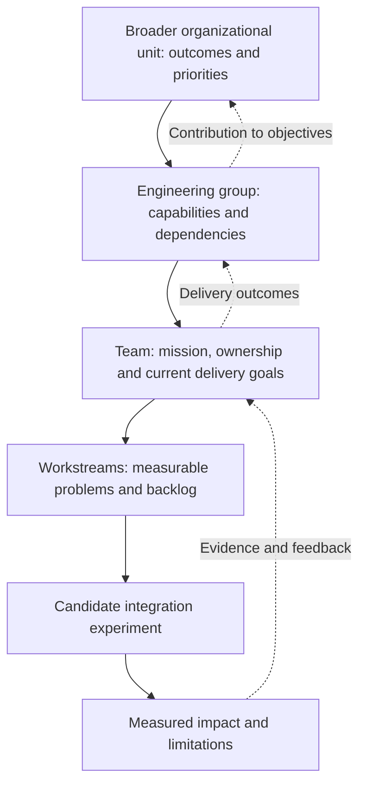
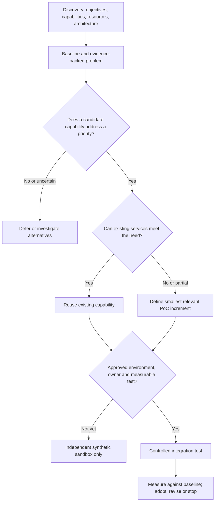

# Phase 0 — Organizational and Technical Discovery

**Status:** proposed discovery protocol; not a completed assessment of any organization.

**Purpose:** establish whether, where and why architectural admission, model-assisted review or execution governance would improve an existing engineering platform. Discovery precedes organization-specific integration; independent sandbox experiments can proceed in parallel.

Start with the organization's outcomes, existing capabilities, constraints and investment. Do not assume the team needs a new orchestration framework, inference service or admission layer. Reuse existing services where they meet the requirements. The standalone PoC is a candidate capability, not a predetermined solution.

## Discovery dimensions

| Dimension | Questions to resolve | Expected evidence |
|---|---|---|
| Organizational context | What is the team's mission? Which engineering group, product or broader unit does it serve? What are that unit's objectives and dependencies? | Objective hierarchy, organizational boundaries, stakeholders and ownership. |
| Team capabilities | Which engineering, platform, architecture, security and AI capabilities are available? Where is additional expertise needed? Who owns design, delivery and operations? | Team-level capability map; no individual employee ratings. |
| Available resources | What inference endpoints, models, compute quotas, environments, CI/CD, IDP, storage, telemetry, identity and engineering capacity are available and approved? | Resource inventory distinguishing availability, access authorization, limits and owners. |
| Current architecture | How are ADRs authored, reviewed and enforced? How do coding agents receive context and permissions? Where do CI/CD and human review fit? | Current-state workflow, trust boundaries, interfaces, policies and failure paths. |
| Goals and current work | What are the current team deliverables, backlog priorities, success metrics and deadlines? Which broader objectives drive them? | Prioritized objectives, measurable outcomes, dependencies and constraints. |
| Pain points and opportunity | Where are delivery delays, architecture drift, rework, review burden, inference cost or authorization gaps actually observed? | Evidence-backed problems and baselines, not assumed deficiencies. |

## Objective hierarchy and feedback

These levels are illustrative, not an asserted reporting hierarchy. Confirm the actual units and relationships. An experiment must have a traceable relationship to a meaningful team or group objective.

## Stakeholder discovery guide

| Perspective | Questions |
|---|---|
| Staff Engineer / senior IC | How does the platform work today? What components should be reused? Where are the bottlenecks and cross-team dependencies? |
| Team Lead | What is the mandate, backlog, capacity and capability mix? Which problems are highest priority? What contribution or ownership is needed? |
| Group Lead | What broader objectives justify investment? How do team priorities relate to the group roadmap and dependencies? |
| Architect | Which design standards, interfaces, data boundaries and approval processes are mandatory? What would compatible integration look like? |
| Platform, inference and security owners, as applicable | Which services and identities are approved? What are the resource limits, operational obligations and data handling requirements? |

Use available approved documentation and conversations with appropriate owners. Confirm actual decision rights; record unresolved differences. Do not request proprietary information inappropriate for an interview or discovery setting.

## Resource and capability assessment

Record resources by category, owner, supported interfaces, availability, authorization, capacity/quotas, operational constraints and evidence date. A resource that exists is not necessarily authorized for use. Map team-level experience, ownership and collaboration opportunities, not individual employee performance.

## Decision process

## Discovery outputs

| Deliverable | Minimum content |
|---|---|
| Objective hierarchy | Organizational outcome → group objective → team outcome → measurable problem. |
| Team capability map | Existing team-level capabilities, owners, gaps and collaboration needs. |
| Resource inventory | Approved infrastructure, interfaces, capacity, access and constraints. |
| Current-state architecture | Workflow, integration points, data flows, ownership and trust boundaries. |
| Gap analysis | Current versus desired state, existing alternatives and evidence for the gap. |
| Integration opportunity map | Candidate capability, objective linkage, reuse option, expected benefit, cost/risk, owner and validation metric. |
| Integration decision record | Proceed, revise, defer or stop; rationale, unresolved questions, authorized scope and acceptance criteria. |

## Readiness gate

- [ ] A specific problem and desired outcome are agreed with an appropriate owner.
- [ ] The team's and broader unit's objectives, current architecture and relevant capabilities are sufficiently understood.
- [ ] Existing internal solutions and reuse opportunities have been considered.
- [ ] Required resources, access, security policies and data/telemetry boundaries are explicitly approved.
- [ ] A limited sandbox test, success metric, baseline, evidence requirements and responsible owner are defined.
- [ ] Dependencies, open questions and reasons to defer are documented.

If these conditions are not met, continue generic standalone/sandbox research without claiming organization-specific integration. The 8–10 December prototyping window does not imply organizational access or approval.

## Public documentation boundary

Only the generic methodology, candidate questions, output templates and readiness gates belong here. Actual organization-specific findings, internal inventories, private architecture, credentials, endpoints, budgets and interview notes belong only in an authorized internal location, if their collection is appropriate and approved. No company assessment or access is asserted here.

## Related plans

- [Mid-December 2026 — Integration Test Intent](Mid-December-2026-Integration-Test-Intent.md)
- [Experiment 001 — JSON vs JSONL for small local models](Experiment-001-JSON-vs-JSONL.md)
